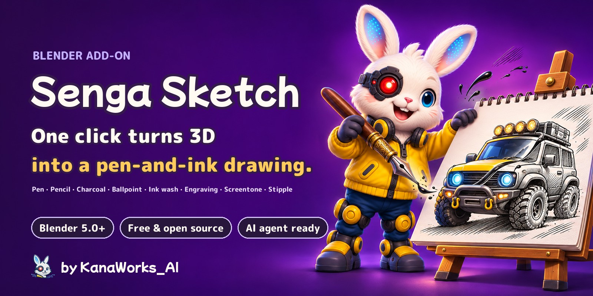
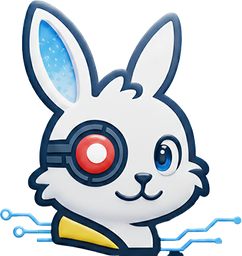
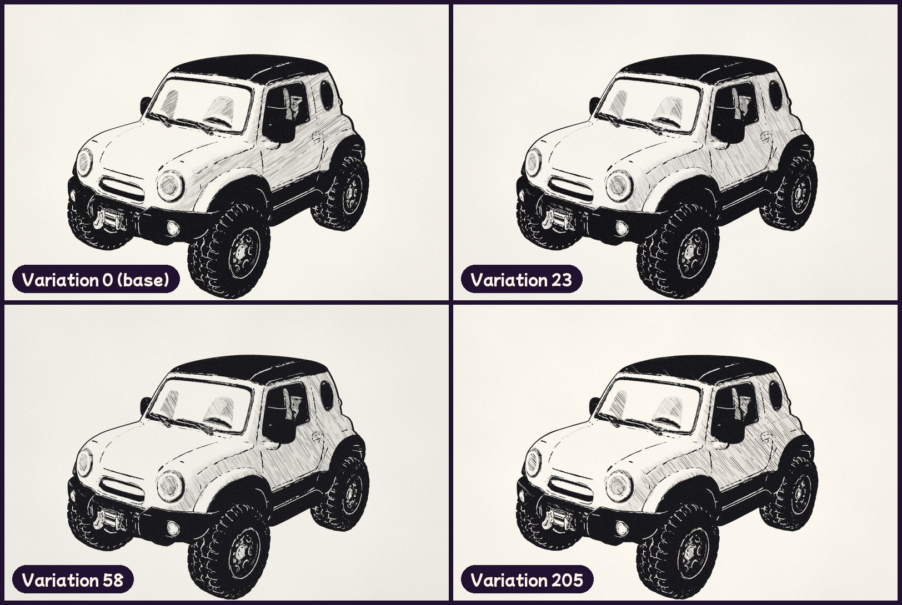
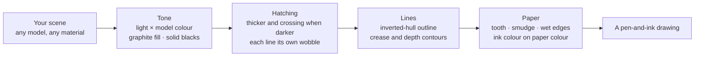
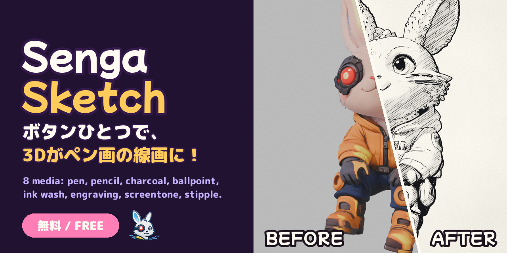

<div align="center">



<p>
  <a href="https://github.com/kanaworksai-hue/senga-sketch/releases/latest"></a>
  
  
  
  
  <a href="LICENSE"></a>
  <a href="NOTICE.md"></a>
  <a href="https://github.com/kanaworksai-hue/senga-sketch/stargazers"></a>
</p>

<p><a href="https://github.com/kanaworksai-hue"></a>&nbsp;<a href="https://github.com/kanaworksai-hue"><b>A KanaWorks_AI project</b></a>&nbsp;·&nbsp;<a href="#-kanaworks-add-ons">All add-ons</a></p>

[日本語](README.md) | **English** | [简体中文](README.zh-CN.md) | [한국어](README.ko.md) | [Português](README.pt-BR.md) | [Español](README.es.md)

[🎨 Gallery](#-gallery) · [🚀 Get started](#-get-started) · [🎛️ What you can tweak](#️-what-you-can-tweak) · [❓ FAQ](#-faq) · [⭐ Star it](#-support-with-a-star)

</div>

**Senga Sketch** (線画スケッチ, "line-drawing sketch") is a free Blender add-on that turns your scene into a pen-and-ink drawing with one click. It reads light and shadow, lays hand-drawn hatching wherever it gets darker, inks the outlines and the inner contour lines, and finishes it all on paper.

Mix **8 media** — manga G-pen, graphite pencil, charcoal, ballpoint, sumi ink wash, engraving, manga screentone and stipple — with **8 papers**, from sketchbook and sepia to kraft with white chalk, chalkboard, blueprint and a light watercolour wash. Every press of **Shuffle** changes the line angle and wobble, and an AI agent can install and apply it for you from one sentence.

<p align="center">
  
  <br><sub>Same model, same camera. Left: a regular render. Right: Senga Sketch.</sub>
</p>

## ✨ Features

<table>
<tr>
<td align="center" width="25%"><br><b>One click</b><br><sub>EEVEE, materials, outlines, contour lines and paper, all set up at once</sub></td>
<td align="center" width="25%"><br><b>8 media × 8 papers</b><br><sub>Pen, pencil, charcoal, ballpoint, ink wash, engraving, screentone, stipple</sub></td>
<td align="center" width="25%"><br><b>Shuffle</b><br><sub>Each press changes line angle, spacing, wobble, breakup and paper shade</sub></td>
<td align="center" width="25%"><br><b>Leave it to AI</b><br><sub>One sentence to your agent: install, apply and preview, all automatic</sub></td>
</tr>
</table>

- **Hatching that looks drawn by hand:** every line has its own weight, spacing, wobble and length, broken into tapered strokes. Lines thicken as it gets darker, then a crossing layer and a third layer join in. Keep the lines fixed on screen (like the drawing this look is based on), or let them bend over the form.
- **Lines like a real pen:** outlines keep a constant on-screen width, get heavier on the side away from the light, swell and thin like pen pressure, and boil on twos. Inner contour lines come from creases and overlaps; inside solid blacks they are scratched out in white so the shape still reads.
- **Finished on paper:** paper tooth breaks up the pencil, charcoal smudges, ink wash pools at its edges. The drawing can fade out towards the frame edges (or the bottom) like an unfinished sketch — shading first, lines last. On dark paper it draws the light instead of the shadow; toned paper gets white chalk highlights.
- **Works on any scene:** objects without materials get one (vertex colours kept), and a key light is added if there is none. Image, Diffuse and Emission materials, text, curves and collection instances are handled. Glass keeps its own shader and is drawn with an outline and a rim tone.
- **Fully reversible:** "Revert Sketch" restores your original materials, compositor and view settings. Settings are read inside the shader, so the file renders the same even without the add-on installed.
- **UI in 日本語, English, 简体中文 and 한국어:** follows Blender's language automatically, or pick one in the 🌐 menu at the top right of the panel.

## 🎨 Gallery

### 8 media

Same model, same light — only the medium changes.


### 8 papers

Media and papers are chosen separately. Toned papers get white chalk; chalkboard and blueprint draw the light.


### Up close


### Shuffle

Each press re-rolls the hatch angle, cross angle, spacing, wobble, breakup, edge fade and paper shade. Keep the number and you can get the exact look back any time.



### Any model

CC0 models, Blender's own Suzanne and models made by the author, each with a single click.


### Four layers


## 🧭 How it works



1. **Tone and hatching (material):** Diffuse → Shader to RGB gives the light, multiplied by how bright the model's own colour is. That darkness drives hand-drawn lines laid in screen space (each line with its own weight, position, wobble and length): they thicken, cross, and the darkest areas go solid black. The result is written to an AOV as "ink coverage".
2. **Lines (Geometry Nodes + compositor):** an inverted hull draws outlines with a constant on-screen width, heavier away from the light, with pen-pressure variation. The compositor adds inner contour lines from normal creases and from (anti-aliased) depth jumps.
3. **Paper (compositor):** paper tooth, smudge, wet edges and the unfinished fade act on the ink coverage, then "ink colour" is laid over "paper colour × wash". That is why black ink on white paper and white chalk on a blackboard use the same graph. Pixel sizes scale with the resolution automatically.

## 🚀 Get started

### Ask your AI agent (recommended)

Send this to an AI agent that can use your computer, such as Claude Code or Codex:

> Follow AGENTS.md at https://github.com/kanaworksai-hue/senga-sketch to install Senga Sketch, then make my Blender scene look like a pen-and-ink drawing.

Then tweak it in one line while you look at the preview:

- "Make it a pencil study"
- "Kraft paper with white chalk"
- "Show me another variation"
- "Finer hatching"
- "Let the bottom fade out like an unfinished sketch"

### Install it yourself

**You need:** Blender 5.0 or later (tested on Blender 5.2), with EEVEE as the render engine.

1. Download `senga_sketch-x.y.z.zip` from [Releases](https://github.com/kanaworksai-hue/senga-sketch/releases/latest) (don't unzip it)
2. Blender → Edit → Preferences → Get Extensions → ⌄ menu at the top right → **Install from Disk…** → pick the zip


### Use it

1. Open your scene (any models and materials)
2. In the 3D Viewport press **N** → **Senga** tab
3. **Make It Senga**
4. Pick a **Medium** and a **Paper**. Can't decide? **Shuffle**
5. Fine-tune in Tone, Hatching, Lines and Paper & Colour, then press **F12** to render

<p align="center">
  
</p>

## 🎛️ What you can tweak

<details>
<summary><b>Main panel</b></summary>

| Setting | What it does |
|---|---|
| Drawing Medium | How it is drawn (manga pen, graphite pencil, charcoal, ballpoint, sumi ink wash, engraving, manga screentone, stipple) |
| Paper | Paper and ink colour (sketchbook, sepia, kraft + white chalk, toned grey + chalk, notebook, blueprint, chalkboard, ink + watercolour) |
| Variation / Shuffle | A number that re-rolls line angle, spacing, wobble, breakup, edge fade and paper shade. 0 = off |
| Selected Objects Only | Apply to the selection only (default: the whole scene) |
| Add Key Light if Missing | Adds a Sun from the camera side when there is no light at all (removed by Revert) |
| Fit to Scene Scale | Sets line width and depth contours from object size and camera distance |
| Revert Sketch / Reset to Defaults | Restore materials, compositor and view settings / every setting back to its default |

</details>

<details>
<summary><b>Media</b></summary>

| Medium | Look |
|---|---|
| **Manga Pen** (default) | Hand hatching that thickens in shadow, solid blacks, light graphite |
| **Graphite Pencil** | Soft graphite shading, fine hatching, paper tooth and smudging, light lines |
| **Charcoal** | Heavy smudged blacks, coarse strokes, rough paper, soft lines |
| **Ballpoint** | Thin crossing lines only, like a pen sketch in a notebook |
| **Sumi Ink Wash** | Brush outlines, three flat ink-wash steps, pooled edges |
| **Engraving** | Fine lines that bend over the form, like an etching or a banknote |
| **Manga Screentone** | Clean ink lines with two-level halftone dots |
| **Stipple** | Shading built from thousands of ink dots |

Media change only the "how it's drawn" settings and papers only the "colour and mood" settings, so you can combine them freely.
</details>

<details>
<summary><b>Main detailed settings</b></summary>

| Group | Settings |
|---|---|
| Tone | Key light, shadow threshold, softness, cel shading, shadow lightness, brightness, texture values, dark texture lift, gloss, graphite fill, solid blacks, dry brush |
| Hatching | Pattern (hatching / screentone / stipple), start, cross-hatch, third layer, **line spacing**, weight, **angle**, hand wobble, breakup, **follow form**, tone steps |
| Lines | Outlines (width, darkness, pen pressure, **shadow-side weight**, boil), contour lines (strength, creases, depth, width, wobble, breakup, **white lines in blacks**) |
| Paper & Colour | Ink colour, paper colour, paper texture, paper tooth, smudge, wet edges, **unfinished edges** (vignette / bottom), colour wash, white chalk, draw the light, ruled lines, grain, vignette |

Per object you can override shadow threshold, shadow lightness, brightness, fill, solid blacks, hatching, colour wash, gloss and line width ("Active Object Override").
</details>

## ❓ FAQ

<details>
<summary><b>Does it work in Cycles?</b></summary>

No. It uses the EEVEE-only "Shader to RGB" node, so render with EEVEE. **Make It Senga** switches to EEVEE for you.
</details>

<details>
<summary><b>The hatching turns into flat grey.</b></summary>

Line spacing is a fraction of the image height, so in a small preview the lines are finer than a pixel and blur into grey. Check at the final resolution, or raise "Line Spacing".
</details>

<details>
<summary><b>The lines are too thick or too thin.</b></summary>

After a big camera move, press "Fit to Scene", then adjust "Line Width". Line width is built to stay the same on screen.
</details>

<details>
<summary><b>Everything is bright, no shadows.</b></summary>

Bright worlds and HDRIs add a lot of fill light. Raise "Ambient Compensation" or "Shadow Threshold".
</details>

<details>
<summary><b>What happens to my original materials?</b></summary>

The sketch node group is inserted in front of the material output and the original link is remembered. "Revert Sketch" puts everything back and removes materials and lights the add-on created.
</details>

<details>
<summary><b>Can I use the images and videos commercially?</b></summary>

Yes. Renders and videos you make with Senga Sketch are your own work, free to use commercially. The GPL covers the add-on's code, not what you make with it (do follow the licences of the models and textures you use). No credit is needed, but `Made with Senga Sketch by @KanaWorks_AI` would make us very happy.
</details>

## 📝 Credit

Senga Sketch is free, including for commercial use.

**If you redistribute, modify or bundle the add-on** (forks, modified versions, ports, inclusion in packs or products, free or paid), you **must** keep this line, unchanged, in the add-on's description and in its documentation (an additional term under GPL-3.0 section 7(b); see [NOTICE.md](NOTICE.md)):

```
Senga Sketch by KanaWorks_AI (@KanaWorks_AI) — https://github.com/kanaworksai-hue/senga-sketch
```

**Images and videos you make** need no credit. If you'd like to add one to your post or description, this is very welcome:

```
Made with Senga Sketch by @KanaWorks_AI
```

## ⭐ Support with a star

If you like Senga Sketch, please press **⭐ Star** at the top right of the [repository page](https://github.com/kanaworksai-hue/senga-sketch). It's free and takes a second.

- **It reaches more people:** more stars make it easier to find on GitHub.
- **It keeps updates coming:** it's what keeps new media and papers coming.

Bug reports and ideas in [Issues](https://github.com/kanaworksai-hue/senga-sketch/issues), or your drawings on X with [@KanaWorks_AI](https://x.com/KanaWorks_AI), are a huge encouragement too.

## 🧩 KanaWorks add-ons

Free, open-source Blender add-ons by the same author. Each one can be installed and applied by an AI agent from one sentence.

<table>
<tr>
<td align="center" width="50%"><a href="https://github.com/kanaworksai-hue/senga-sketch"></a><br><b>Senga Sketch</b> (this page)<br><sub>3D into pen-and-ink drawings: hatching, pencil, engraving, screentone</sub></td>
<td align="center" width="50%"><a href="https://github.com/kanaworksai-hue/harappa"></a><br><b><a href="https://github.com/kanaworksai-hue/harappa">Harappa</a></b><br><sub>Anime-background meadows, trees and sky, plus ponds, waterfalls and weather, in one click</sub></td>
</tr>
<tr>
<td align="center" width="50%"><a href="https://github.com/kanaworksai-hue/painterly-25d"></a><br><b><a href="https://github.com/kanaworksai-hue/painterly-25d">Painterly 2.5D</a></b><br><sub>3D into hand-painted art: oil, watercolour, crayon, anime cel</sub></td>
<td align="center" width="50%"><a href="https://github.com/kanaworksai-hue/kirapaint"></a><br><b><a href="https://github.com/kanaworksai-hue/kirapaint">KiraPaint</a></b><br><sub>3D into sparkly painterly 2.5D: crushed-diamond gloss and starlight</sub></td>
</tr>
<tr>
<td align="center" width="50%"><a href="https://github.com/kanaworksai-hue/mochitoon"></a><br><b><a href="https://github.com/kanaworksai-hue/mochitoon">MochiToon</a></b><br><sub>3D into a cute comic look: coloured shadows, heart and star halftones</sub></td>
<td align="center" width="50%"></td>
</tr>
</table>

## 🛠️ Development

```bash
# headless test (every feature on a generic scene the add-on was never tuned for)
blender -b --factory-startup --python tests/test_generic.py

# build the installable zip into dist/
BLENDER=blender ./build.sh
```

```
senga_sketch/
  __init__.py      settings, media / papers / variation, operators
  shade.py         sketch shader node group (tone, hatching, screentone / stipple, solid blacks, wash, AOVs)
  outline.py       Geometry Nodes outline (heavier away from the light, pen pressure, boil)
  post.py          compositor (contours, white lines, paper tooth, smudge, wet edges, unfinished fade, paper and ink)
  autosetup.py     makes it work on any scene (materials, lights, scale)
  ui.py / i18n.py  panel and UI translations (日本語, English, 简体中文, 한국어)
agent/senga_agent.py  command line for AI agents
```

## 📄 License and credits

- **This add-on:** Copyright © 2026 東京AI映像合同会社 (Tokyo AI Visuals LLC). Released under [GPL-3.0-or-later](LICENSE) (with an additional term asking for attribution when you redistribute it; see [NOTICE.md](NOTICE.md)).
- **Brand:** the KanaWorks_AI name, the logo and the character Kana belong to Tokyo AI Visuals LLC and are **not** covered by the GPL. See [docs/brand](docs/brand/README.md).
- The NPR techniques that make 3D look like a pen drawing (tone from Shader to RGB, screen-space hatching, inverted-hull outlines, contour extraction from normals and depth) are widely shared in the Blender and Maya / Arnold communities; this add-on builds on that common knowledge.
- **Blender** is a trademark of the Blender Foundation. This is an independent project, not affiliated with or endorsed by the Blender Foundation.

<br>

<div align="center">

<a href="https://x.com/KanaWorks_AI"></a>

<p><b>Made with ♥ by <a href="https://x.com/KanaWorks_AI">KanaWorks_AI</a></b></p>

<p><sub>If Senga Sketch helped you, a ⭐ keeps the next update coming. More projects: <a href="https://github.com/kanaworksai-hue">github.com/kanaworksai-hue</a></sub></p>

</div>
