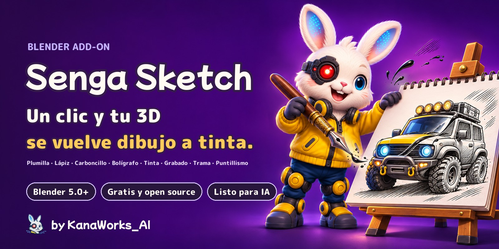
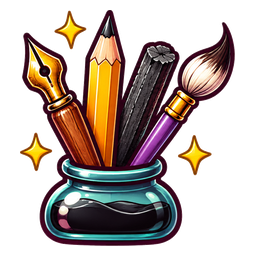
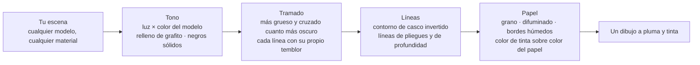

<div align="center">



<p>
  <a href="https://github.com/kanaworksai-hue/senga-sketch/releases/latest"></a>
  
  
  
  
  <a href="LICENSE"></a>
  <a href="NOTICE.md"></a>
  <a href="https://github.com/kanaworksai-hue/senga-sketch/stargazers"></a>
</p>

<p><a href="https://github.com/kanaworksai-hue"></a>&nbsp;<a href="https://github.com/kanaworksai-hue"><b>Un proyecto de KanaWorks_AI</b></a>&nbsp;·&nbsp;<a href="#-add-ons-de-kanaworks">Todos los add-ons</a></p>

[日本語](README.md) | [English](README.en.md) | [简体中文](README.zh-CN.md) | [한국어](README.ko.md) | [Português](README.pt-BR.md) | **Español**

[🎨 Galería](#-galería) · [🚀 Primeros pasos](#-primeros-pasos) · [🎛️ Qué puedes ajustar](#️-qué-puedes-ajustar) · [❓ Preguntas frecuentes](#-preguntas-frecuentes) · [⭐ Dale una estrella](#-apóyalo-con-una-estrella)

</div>

**Senga Sketch** (線画スケッチ, "boceto de dibujo lineal") es un add-on gratuito para Blender que convierte tu escena en un dibujo a pluma y tinta con un solo clic. Lee la luz y la sombra, traza un tramado hecho a mano allí donde la imagen se oscurece, entinta los contornos y las líneas interiores, y lo remata todo sobre papel.

Combina **8 técnicas** —plumilla G de manga, lápiz de grafito, carboncillo, bolígrafo, aguada de tinta sumi, grabado, trama de puntos de manga y punteado— con **8 papeles**, desde cuaderno de bocetos y sepia hasta papel kraft con tiza blanca, pizarra, plano azul y una ligera aguada de acuarela. Cada vez que pulsas **Shuffle** cambian el ángulo y el temblor de las líneas, y un agente de IA puede instalarlo y aplicarlo por ti con una sola frase.

<p align="center">
  
  <br><sub>Mismo modelo, misma cámara. Izquierda: un render normal. Derecha: Senga Sketch.</sub>
</p>

## ✨ Características

<table>
<tr>
<td align="center" width="25%"><br><b>Un solo clic</b><br><sub>Configura EEVEE, materiales, contornos, líneas interiores y papel de una sola vez</sub></td>
<td align="center" width="25%"><br><b>8 técnicas × 8 papeles</b><br><sub>Pluma, lápiz, carboncillo, bolígrafo, aguada de tinta, grabado, trama de puntos, punteado</sub></td>
<td align="center" width="25%"><br><b>Shuffle</b><br><sub>Cada clic cambia el ángulo, el espaciado, el temblor y la fragmentación de las líneas, y el tono del papel</sub></td>
<td align="center" width="25%"><br><b>Pídeselo a tu IA</b><br><sub>Una frase a tu agente: instalación, aplicación y vista previa, todo automático</sub></td>
</tr>
</table>

- **Un tramado que parece hecho a mano:** cada línea tiene su propio grosor, espaciado, temblor y longitud, y se rompe en trazos que se afinan en las puntas. Las líneas se engrosan a medida que oscurece y después se suman una capa cruzada y una tercera capa. Puedes dejar las líneas fijas en pantalla (como en el dibujo en el que se inspira este estilo) o hacer que se curven siguiendo la forma.
- **Líneas como las de una pluma de verdad:** los contornos mantienen un grosor constante en pantalla, se vuelven más gruesos en el lado contrario a la luz, se ensanchan y adelgazan como con la presión de la pluma y tiemblan a dos fotogramas. Las líneas interiores salen de los pliegues y las superposiciones; dentro de los negros sólidos se raspan en blanco para que la forma se siga leyendo.
- **Acabado sobre papel:** el grano del papel rompe el trazo del lápiz, el carboncillo se difumina y la aguada de tinta se acumula en sus bordes. El dibujo puede desvanecerse hacia los bordes del encuadre (o hacia abajo) como un boceto sin terminar: primero desaparece el sombreado y, al final, las líneas. Sobre papel oscuro dibuja la luz en lugar de la sombra; el papel de color recibe luces con tiza blanca.
- **Funciona en cualquier escena:** los objetos sin material reciben uno (se conservan los colores de vértice), y se añade una luz principal si no hay ninguna. Admite materiales de imagen, Diffuse y Emission, textos, curvas e instancias de colección. El vidrio conserva su propio shader y se dibuja con un contorno y un tono en el borde.
- **Totalmente reversible:** "Revert Sketch" restaura tus materiales originales, el compositor y los ajustes de vista. Los ajustes se leen dentro del shader, así que el archivo se renderiza igual aunque no tengas el add-on instalado.
- **Interfaz en 日本語, English, 简体中文 y 한국어:** sigue automáticamente el idioma de Blender, o puedes elegir uno en el menú 🌐 de arriba a la derecha del panel.

## 🎨 Galería

### 8 técnicas

Mismo modelo, misma luz. Solo cambia la técnica.


### 8 papeles

Las técnicas y los papeles se eligen por separado. Los papeles de color llevan tiza blanca; en la pizarra y el plano azul se dibuja la luz.


### De cerca


### Shuffle

Cada clic vuelve a sortear el ángulo del tramado, el ángulo de la capa cruzada, el espaciado, el temblor, la fragmentación, el desvanecido de los bordes y el tono del papel. Apunta el número y podrás recuperar ese mismo aspecto cuando quieras.


### Cualquier modelo

Modelos CC0, la propia Suzanne de Blender y modelos de la autora, cada uno con un solo clic.


### Cuatro capas


## 🧭 Cómo funciona



1. **Tono y tramado (material):** Diffuse → Shader to RGB da la luz, que se multiplica por la luminosidad del propio color del modelo. Esa oscuridad controla unas líneas hechas a mano trazadas en el espacio de pantalla (cada una con su propio grosor, posición, temblor y longitud): se engrosan, se cruzan y las zonas más oscuras pasan a negro sólido. El resultado se escribe en un AOV como "cobertura de tinta".
2. **Líneas (Geometry Nodes + compositor):** un casco invertido dibuja contornos de grosor constante en pantalla, más gruesos en el lado contrario a la luz y con variaciones de presión de pluma. El compositor añade las líneas interiores a partir de los pliegues de las normales y de los saltos de profundidad (con antialiasing).
3. **Papel (compositor):** el grano del papel, el difuminado, los bordes húmedos y el desvanecido de boceto sin terminar actúan sobre la cobertura de tinta, y después se aplica el "color de tinta" sobre "color del papel × aguada". Por eso la tinta negra sobre papel blanco y la tiza blanca sobre una pizarra usan el mismo grafo. Los tamaños en píxeles se ajustan automáticamente a la resolución.

## 🚀 Primeros pasos

### Pídeselo a tu agente de IA (recomendado)

Envía esto a un agente de IA que pueda usar tu ordenador, como Claude Code o Codex:

> Sigue el AGENTS.md de https://github.com/kanaworksai-hue/senga-sketch para instalar Senga Sketch y hacer que mi escena de Blender parezca un dibujo a pluma y tinta.

Después, ajústalo con una sola frase mientras miras la vista previa:

- "Hazlo como un estudio a lápiz"
- "Papel kraft con tiza blanca"
- "Enséñame otra variación"
- "Tramado más fino"
- "Que la parte de abajo se desvanezca como un boceto sin terminar"

### Instálalo tú mismo

**Necesitas:** Blender 5.0 o posterior (probado en Blender 5.2) y el motor de render EEVEE.

1. Descarga `senga_sketch-x.y.z.zip` desde [Releases](https://github.com/kanaworksai-hue/senga-sketch/releases/latest) (no lo descomprimas)
2. Blender → Edit → Preferences → Get Extensions → el menú ⌄ de arriba a la derecha → **Install from Disk…** → elige el zip


### Úsalo

1. Abre tu escena (cualquier modelo y material)
2. En el 3D Viewport pulsa **N** → pestaña **Senga**
3. Haz clic en **Make It Senga**
4. Elige un **Medium** y un **Paper**. ¿No te decides? Pulsa **Shuffle**
5. Afina los detalles en *Tone*, *Hatching*, *Lines* y *Paper & Colour*, y pulsa **F12** para renderizar

<p align="center">
  
</p>

## 🎛️ Qué puedes ajustar

<details>
<summary><b>Panel principal</b></summary>

| Opción | Qué hace |
|---|---|
| Drawing Medium | Cómo se dibuja (plumilla de manga, lápiz de grafito, carboncillo, bolígrafo, aguada de tinta sumi, grabado, trama de puntos de manga, punteado) |
| Paper | Papel y color de tinta (cuaderno de bocetos, sepia, kraft + tiza blanca, gris tintado + tiza, libreta, plano azul, pizarra, tinta + acuarela) |
| Variation / Shuffle | Un número que vuelve a sortear el ángulo, el espaciado, el temblor y la fragmentación de las líneas, el desvanecido de los bordes y el tono del papel. 0 = desactivado |
| Selected Objects Only | Lo aplica solo a la selección (por defecto: toda la escena) |
| Add Key Light if Missing | Añade un Sun desde el lado de la cámara si no hay ninguna luz (Revert lo elimina) |
| Fit to Scene Scale | Ajusta el grosor de línea y las líneas de profundidad según el tamaño de los objetos y la distancia de la cámara |
| Revert Sketch / Reset to Defaults | Restaura los materiales, el compositor y los ajustes de vista / devuelve todos los ajustes a sus valores por defecto |

</details>

<details>
<summary><b>Técnicas</b></summary>

| Medium | Aspecto |
|---|---|
| **Manga Pen** (por defecto) | Tramado a mano que se engrosa en la sombra, negros sólidos, un ligero relleno de grafito |
| **Graphite Pencil** | Sombreado suave de grafito, tramado fino, grano del papel y difuminado, líneas claras |
| **Charcoal** | Negros intensos y difuminados, trazos gruesos, papel rugoso, líneas suaves |
| **Ballpoint** | Solo líneas finas cruzadas, como un boceto a bolígrafo en una libreta |
| **Sumi Ink Wash** | Contornos a pincel, tres niveles planos de aguada de tinta, tinta acumulada en los bordes |
| **Engraving** | Líneas finas que se curvan siguiendo la forma, como un aguafuerte o un billete |
| **Manga Screentone** | Líneas de tinta limpias con puntos de semitono a dos niveles |
| **Stipple** | Sombreado hecho con miles de puntos de tinta |

Las técnicas solo cambian los ajustes de "cómo se dibuja" y los papeles solo los de "color y ambiente", así que puedes combinarlos libremente.
</details>

<details>
<summary><b>Principales ajustes de detalle</b></summary>

| Grupo | Ajustes |
|---|---|
| Tono | Luz principal, umbral de sombra, suavidad, sombreado cel, claridad de la sombra, brillo, valores de textura, realce de texturas oscuras, brillo especular, relleno de grafito, negros sólidos, pincel seco |
| Tramado | Patrón (tramado / trama de puntos / punteado), inicio, tramado cruzado, tercera capa, **espaciado de líneas**, grosor, **ángulo**, temblor de mano, fragmentación, **seguir la forma**, niveles de tono |
| Líneas | Contornos (grosor, oscuridad, presión de pluma, **grosor en el lado de sombra**, temblor a dos fotogramas), líneas interiores (intensidad, pliegues, profundidad, grosor, temblor, fragmentación, **líneas blancas en los negros**) |
| Papel y color | Color de tinta, color del papel, textura del papel, grano del papel, difuminado, bordes húmedos, **bordes sin terminar** (viñeta / parte inferior), aguada de color, tiza blanca, dibujar la luz, renglones, granulado, viñeta |

Por objeto puedes sobrescribir el umbral de sombra, la claridad de la sombra, el brillo, el relleno, los negros sólidos, el tramado, la aguada de color, el brillo especular y el grosor de línea ("Active Object Override").
</details>

## ❓ Preguntas frecuentes

<details>
<summary><b>¿Funciona en Cycles?</b></summary>

No. Usa el nodo "Shader to RGB", exclusivo de EEVEE, así que renderiza con EEVEE. **Make It Senga** cambia la escena a EEVEE por ti.
</details>

<details>
<summary><b>El tramado se convierte en un gris uniforme.</b></summary>

El espaciado de las líneas es una fracción de la altura de la imagen, así que en una vista previa pequeña las líneas son más finas que un píxel y se funden en gris. Compruébalo a la resolución final o sube "Line Spacing".
</details>

<details>
<summary><b>Las líneas son demasiado gruesas o demasiado finas.</b></summary>

Después de mover mucho la cámara, pulsa "Fit to Scene" y luego ajusta "Line Width". El grosor de línea está pensado para mantenerse igual en pantalla.
</details>

<details>
<summary><b>Todo está iluminado y no hay sombras.</b></summary>

Los fondos (World) muy luminosos y los HDRI añaden mucha luz de relleno. Sube "Ambient Compensation" o "Shadow Threshold".
</details>

<details>
<summary><b>¿Qué pasa con mis materiales originales?</b></summary>

El grupo de nodos del boceto se inserta delante de la salida del material y se recuerda la conexión original. "Revert Sketch" lo deja todo como estaba y además elimina los materiales y las luces que creó el add-on.
</details>

<details>
<summary><b>¿Puedo usar las imágenes y los vídeos con fines comerciales?</b></summary>

Sí. Los renders y vídeos que hagas con Senga Sketch son obra tuya y puedes usarlos libremente con fines comerciales. La GPL cubre el código del add-on, no lo que creas con él (eso sí, respeta las licencias de los modelos y texturas que uses). No hace falta dar créditos, pero `Made with Senga Sketch by @KanaWorks_AI` nos haría muy felices.
</details>

## 📝 Créditos

Senga Sketch es gratis, también para uso comercial.

**Si redistribuyes, modificas o incluyes el add-on en otro producto** (forks, versiones modificadas, ports, packs o productos que lo incluyan, gratis o de pago), es **obligatorio** mantener esta línea, sin cambios, en la descripción del add-on y en su documentación (término adicional de la sección 7(b) de la GPL-3.0; consulta [NOTICE.md](NOTICE.md)):

```
Senga Sketch by KanaWorks_AI (@KanaWorks_AI) — https://github.com/kanaworksai-hue/senga-sketch
```

**Las imágenes y vídeos que hagas** no necesitan créditos. Si quieres añadirlos a tu publicación o descripción, esta línea es muy bienvenida:

```
Made with Senga Sketch by @KanaWorks_AI
```

## ⭐ Apóyalo con una estrella

Si te gusta Senga Sketch, pulsa **⭐ Star** arriba a la derecha de [la página del repositorio](https://github.com/kanaworksai-hue/senga-sketch). Es gratis y lleva un segundo.

- **Llega a más gente:** cuantas más estrellas, más fácil es encontrarlo en GitHub.
- **Mantiene vivas las actualizaciones:** es lo que hace que sigan llegando nuevas técnicas y papeles.

Los reportes de errores y las ideas en [Issues](https://github.com/kanaworksai-hue/senga-sketch/issues), o tus dibujos en X con [@KanaWorks_AI](https://x.com/KanaWorks_AI), también son un enorme apoyo.

## 🧩 Add-ons de KanaWorks

Add-ons gratuitos y de código abierto para Blender, de la misma autora. Un agente de IA puede instalar y aplicar cualquiera de ellos con una sola frase.

<table>
<tr>
<td align="center" width="50%"><a href="https://github.com/kanaworksai-hue/senga-sketch"></a><br><b>Senga Sketch</b> (esta página)<br><sub>Del 3D al dibujo a pluma y tinta: tramado, lápiz, grabado, trama de puntos</sub></td>
<td align="center" width="50%"><a href="https://github.com/kanaworksai-hue/harappa"></a><br><b><a href="https://github.com/kanaworksai-hue/harappa">Harappa</a></b><br><sub>Prados, árboles y cielo de fondo de anime, con estanques, cascadas y clima, en un solo clic</sub></td>
</tr>
<tr>
<td align="center" width="50%"><a href="https://github.com/kanaworksai-hue/painterly-25d"></a><br><b><a href="https://github.com/kanaworksai-hue/painterly-25d">Painterly 2.5D</a></b><br><sub>De 3D a arte pintado a mano: óleo, acuarela, cera, cel de anime</sub></td>
<td align="center" width="50%"><a href="https://github.com/kanaworksai-hue/kirapaint"></a><br><b><a href="https://github.com/kanaworksai-hue/kirapaint">KiraPaint</a></b><br><sub>De 3D a pintura 2.5D brillante: destellos de diamante triturado y luz de estrellas</sub></td>
</tr>
<tr>
<td align="center" width="50%"><a href="https://github.com/kanaworksai-hue/mochitoon"></a><br><b><a href="https://github.com/kanaworksai-hue/mochitoon">MochiToon</a></b><br><sub>De 3D a un estilo de cómic adorable: sombras de color, semitonos de corazones y estrellas</sub></td>
<td align="center" width="50%"></td>
</tr>
</table>

## 🛠️ Desarrollo

```bash
# prueba sin interfaz (todas las funciones en una escena genérica para la que el add-on nunca se ajustó)
blender -b --factory-startup --python tests/test_generic.py

# genera el zip instalable en dist/
BLENDER=blender ./build.sh
```

```
senga_sketch/
  __init__.py      ajustes, técnicas / papeles / variación, operadores
  shade.py         grupo de nodos del shader de boceto (tono, tramado, trama de puntos / punteado, negros sólidos, aguada, AOVs)
  outline.py       contorno con Geometry Nodes (más grueso en el lado contrario a la luz, presión de pluma, temblor a dos fotogramas)
  post.py          compositor (líneas interiores, líneas blancas, grano del papel, difuminado, bordes húmedos, desvanecido sin terminar, papel y tinta)
  autosetup.py     hace que funcione en cualquier escena (materiales, luces, escala)
  ui.py / i18n.py  panel y traducciones de la interfaz (日本語, English, 简体中文, 한국어)
agent/senga_agent.py  línea de comandos para agentes de IA
```

## 📄 Licencia y créditos

- **Este add-on:** Copyright © 2026 東京AI映像合同会社 (Tokyo AI Visuals LLC). Publicado bajo [GPL-3.0-or-later](LICENSE) (con un término adicional que pide la atribución al redistribuirlo; consulta [NOTICE.md](NOTICE.md)).
- **Marca:** el nombre KanaWorks_AI, el logotipo y el personaje Kana pertenecen a Tokyo AI Visuals LLC y **no** están cubiertos por la GPL. Consulta [docs/brand](docs/brand/README.md).
- Las técnicas NPR que hacen que el 3D parezca un dibujo a pluma (tono a partir de Shader to RGB, tramado en el espacio de pantalla, contornos de casco invertido, extracción de líneas a partir de normales y profundidad) están muy difundidas en las comunidades de Blender y de Maya / Arnold; este add-on se apoya en ese conocimiento compartido.
- **Blender** es una marca registrada de la Blender Foundation. Este es un proyecto independiente, sin afiliación ni respaldo de la Blender Foundation.

<br>

<div align="center">

<a href="https://x.com/KanaWorks_AI"></a>

<p><b>Hecho con ♥ por <a href="https://x.com/KanaWorks_AI">KanaWorks_AI</a></b></p>

<p><sub>Si Senga Sketch te ha sido útil, una ⭐ mantiene vivas las actualizaciones. Más proyectos: <a href="https://github.com/kanaworksai-hue">github.com/kanaworksai-hue</a></sub></p>

</div>
