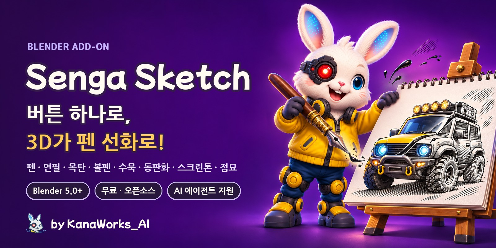
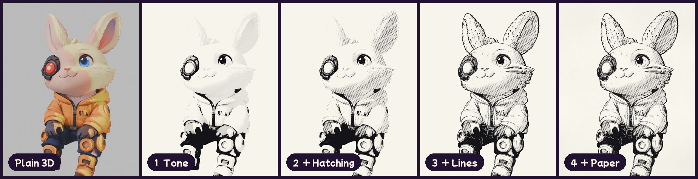
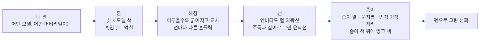
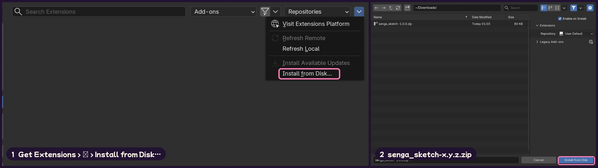

<div align="center">



<p>
  <a href="https://github.com/kanaworksai-hue/senga-sketch/releases/latest"></a>
  
  
  
  
  <a href="LICENSE"></a>
  <a href="NOTICE.md"></a>
  <a href="https://github.com/kanaworksai-hue/senga-sketch/stargazers"></a>
</p>

<p><a href="https://github.com/kanaworksai-hue"></a>&nbsp;<a href="https://github.com/kanaworksai-hue"><b>A KanaWorks_AI project</b></a>&nbsp;·&nbsp;<a href="#-kanaworks-애드온">다른 애드온 보기</a></p>

[日本語](README.md) | [English](README.en.md) | [简体中文](README.zh-CN.md) | **한국어** | [Português](README.pt-BR.md) | [Español](README.es.md)

[🎨 갤러리](#-갤러리) · [🚀 시작하기](#-시작하기) · [🎛️ 조정할 수 있는 항목](#️-조정할-수-있는-항목) · [❓ 자주 묻는 질문](#-자주-묻는-질문) · [⭐ 스타 누르기](#-스타로-응원하기)

</div>

**Senga Sketch**(線画スケッチ, '선화 스케치')는 클릭 한 번으로 씬을 펜으로 그린 선화로 바꿔 주는 무료 Blender 애드온입니다. 빛과 그림자를 읽어 어두워지는 곳마다 손으로 그은 해칭을 넣고, 외곽선과 안쪽 윤곽선을 잉크로 그린 다음, 종이 위에서 마무리해요.

**만화 펜(G펜), 연필 소묘, 목탄, 볼펜, 수묵, 동판화, 만화 스크린톤, 점묘** 이렇게 **8가지 재료**와, 스케치북과 세피아부터 크라프트지 + 흰 분필, 칠판, 청사진, 엷은 담채까지 **8가지 종이**를 자유롭게 조합할 수 있어요. **셔플**(Shuffle)을 누를 때마다 선의 각도와 흔들림이 바뀌고, AI 에이전트에게 한 문장만 보내면 설치부터 적용까지 알아서 해 주기도 해요.

<p align="center">
  
  <br><sub>같은 모델, 같은 카메라. 왼쪽은 일반 렌더, 오른쪽은 Senga Sketch를 적용한 결과예요.</sub>
</p>

## ✨ 주요 기능

<table>
<tr>
<td align="center" width="25%"><br><b>클릭 한 번</b><br><sub>EEVEE, 머티리얼, 외곽선, 윤곽선, 종이까지 한 번에 세팅</sub></td>
<td align="center" width="25%"><br><b>재료 8종 × 종이 8종</b><br><sub>펜, 연필, 목탄, 볼펜, 수묵, 동판화, 스크린톤, 점묘</sub></td>
<td align="center" width="25%"><br><b>셔플</b><br><sub>누를 때마다 선 각도, 간격, 흔들림, 끊김, 종이 색조가 새로 바뀜</sub></td>
<td align="center" width="25%"><br><b>AI에게 맡기기</b><br><sub>에이전트에게 한 문장만 보내면 설치, 적용, 미리보기까지 자동</sub></td>
</tr>
</table>

- **손으로 그린 듯한 해칭:** 선 하나하나의 굵기, 간격, 흔들림, 길이가 모두 다르고, 끝이 가늘어지는 짧은 획으로 끊어져요. 어두워질수록 선이 굵어지고, 이어서 교차하는 선과 세 번째 선이 겹쳐집니다. 선을 화면에 고정할 수도 있고(이 스타일의 바탕이 된 그림처럼), 형태를 따라 휘게 할 수도 있어요.
- **진짜 펜 같은 선:** 외곽선은 화면상 두께가 일정하고, 빛 반대쪽에서 더 굵어지며, 필압처럼 굵어졌다 가늘어졌다 하고, 2프레임마다 살짝 흔들려요. 안쪽 윤곽선은 접힌 곳과 겹친 곳에서 생기고, 먹칠 안에서는 흰 선으로 긁어내서 형태가 그대로 읽힙니다.
- **종이 위의 마무리:** 종이 결에 연필이 거칠게 끊기고, 목탄은 문질러져 번지고, 수묵은 가장자리에 먹이 고여요. 미완성 스케치처럼 화면 가장자리(또는 아래쪽)로 갈수록 그림이 사라지게 할 수도 있어요. 음영이 먼저 사라지고 선은 마지막까지 남습니다. 어두운 종이에서는 그림자 대신 빛을 그리고, 색지에는 흰 분필로 하이라이트를 넣어요.
- **어떤 씬에서도 동작:** 머티리얼이 없는 오브젝트에는 새로 만들어 주고(버텍스 컬러는 그대로 유지), 조명이 없으면 키 라이트를 추가해요. 이미지, Diffuse, Emission 머티리얼, 텍스트, 커브, 컬렉션 인스턴스도 처리합니다. 유리는 원래 셰이더를 그대로 두고, 외곽선과 가장자리 음영으로 그려요.
- **언제든 되돌리기:** "선화 되돌리기"를 누르면 원래 머티리얼, 컴포지터, 뷰 설정이 돌아옵니다. 설정값은 셰이더 안에서 읽어 오기 때문에, 애드온이 설치되지 않은 환경에서도 똑같이 렌더링돼요.
- **UI는 日本語, English, 简体中文, 한국어 지원:** Blender의 언어 설정을 자동으로 따르고, 패널 오른쪽 위의 🌐 메뉴에서 따로 고를 수도 있어요.

## 🎨 갤러리

### 8가지 재료

같은 모델, 같은 조명. 재료만 바꿨어요.


### 8가지 종이

재료와 종이는 따로 고를 수 있어요. 색지에는 흰 분필이 들어가고, 칠판과 청사진에서는 빛을 그립니다.


### 가까이서 보기


### 셔플

누를 때마다 해칭 각도, 교차 각도, 간격, 흔들림, 끊김, 가장자리 페이드, 종이 색조가 새로 뽑혀요. 번호를 적어 두면 언제든 똑같은 결과를 다시 불러올 수 있어요.


### 어떤 모델이든

CC0 모델, Blender 기본 모델인 Suzanne, 제작자가 만든 모델까지 모두 클릭 한 번으로 적용했어요.


### 4개의 레이어



## 🧭 작동 방식



1. **톤과 해칭(머티리얼):** Diffuse → Shader to RGB로 빛을 얻고, 모델 고유색의 밝기를 곱합니다. 이렇게 얻은 어둡기에 따라 화면 공간에 그은 손그림 선(선마다 굵기, 위치, 흔들림, 길이가 다름)이 굵어지고, 교차하며, 가장 어두운 부분은 먹칠이 돼요. 결과는 '잉크 양'으로 AOV에 기록됩니다.
2. **선(Geometry Nodes + 컴포지터):** 인버티드 헐로 화면상 두께가 일정한 외곽선을 그리고, 빛 반대쪽은 더 굵게, 필압처럼 강약을 줍니다. 컴포지터에서는 노멀이 꺾이는 곳과 (안티앨리어싱된) 깊이 차이에서 안쪽 윤곽선을 더해요.
3. **종이(컴포지터):** 잉크 양에 종이 결, 문지름, 번짐 가장자리, 미완성 페이드를 적용한 뒤, '종이 색 × 담채' 위에 '잉크 색'을 얹습니다. 그래서 흰 종이 위의 검은 잉크도, 칠판 위의 흰 분필도 같은 그래프로 그릴 수 있어요. 픽셀 단위 크기는 해상도에 맞춰 자동으로 조정됩니다.

## 🚀 시작하기

### AI 에이전트에게 맡기기 (추천)

Claude Code나 Codex처럼 컴퓨터를 조작할 수 있는 AI 에이전트에게 이렇게 보내 보세요.

> https://github.com/kanaworksai-hue/senga-sketch 의 AGENTS.md를 따라서 Senga Sketch를 설치하고, 내 Blender 씬을 펜으로 그린 선화처럼 만들어 줘.

그다음엔 미리보기를 보면서 한 줄로 수정을 요청하면 돼요.

- "연필 소묘로 바꿔 줘"
- "크라프트지에 흰 분필로"
- "다른 버전도 보여 줘"
- "해칭을 더 촘촘하게"
- "아래쪽은 미완성 스케치처럼 사라지게 해 줘"

### 직접 설치하기

**필요한 것:** Blender 5.0 이상(Blender 5.2에서 테스트됨), EEVEE 렌더 엔진.

1. [Releases](https://github.com/kanaworksai-hue/senga-sketch/releases/latest)에서 `senga_sketch-x.y.z.zip`을 내려받으세요(압축은 풀지 마세요).
2. Blender → Edit → Preferences → Get Extensions → 오른쪽 위 ⌄ 메뉴 → **Install from Disk…** → zip 파일을 선택합니다.



### 사용 방법

1. 씬을 엽니다(어떤 모델, 어떤 머티리얼이든 괜찮아요).
2. 3D 뷰포트에서 **N** 키를 누르고 → **Senga** 탭을 엽니다.
3. **선화로 만들기**(Make It Senga)를 클릭합니다.
4. **재료**와 **종이**를 고릅니다. 고민된다면 **셔플**을 눌러 보세요.
5. "톤 (명암)", "해칭", "선", "종이와 색"에서 세부 조정을 한 뒤 **F12**로 렌더링합니다.

<p align="center">
  
</p>

## 🎛️ 조정할 수 있는 항목

<details>
<summary><b>메인 패널</b></summary>

| 옵션 | 설명 |
|---|---|
| 재료 | 그리는 방식(만화 펜, 연필 소묘, 목탄, 볼펜, 수묵, 동판화, 만화 스크린톤, 점묘) |
| 종이 | 종이와 잉크 색(스케치북, 크림지에 세피아, 크라프트지 + 흰 분필, 회색 색지 + 분필, 노트, 청사진, 칠판, 펜 + 담채) |
| 변형 / 셔플 | 선 각도, 간격, 흔들림, 끊김, 가장자리 페이드, 종이 색조를 새로 뽑는 번호. 0이면 꺼짐 |
| 선택한 오브젝트만 | 선택한 오브젝트에만 적용(기본값: 씬 전체) |
| 키 라이트가 없으면 추가 | 조명이 하나도 없으면 카메라 쪽에서 비추는 Sun 라이트를 추가(되돌리면 삭제됨) |
| 씬 스케일에 맞추기 | 오브젝트 크기와 카메라 거리를 바탕으로 선 너비와 깊이 윤곽선을 설정 |
| 선화 되돌리기 / 기본값으로 | 원래 머티리얼, 컴포지터, 뷰 설정으로 되돌리기 / 모든 설정을 기본값으로 |

</details>

<details>
<summary><b>재료</b></summary>

| 재료 | 느낌 |
|---|---|
| **만화 펜 (G펜)** (기본값) | 그림자에서 굵어지는 손그림 해칭, 먹칠, 옅은 흑연 칠 |
| **연필 소묘** | 부드러운 흑연 음영, 가는 해칭, 종이 결과 문지름, 연한 선 |
| **목탄** | 문질러진 짙은 검정, 거친 획, 거친 종이, 부드러운 선 |
| **볼펜** | 노트에 끄적인 펜 스케치처럼 가는 교차 선만 |
| **수묵** | 붓으로 그은 외곽선, 3단계의 평평한 먹 농담, 가장자리에 고인 먹 |
| **동판화** | 에칭이나 지폐처럼 형태를 따라 휘는 가는 선 |
| **만화 스크린톤** | 깔끔한 잉크 선과 2단계 하프톤 망점 |
| **점묘** | 수천 개의 잉크 점으로 쌓아 올린 음영 |

재료는 '어떻게 그릴지'에 관한 설정만, 종이는 '색감과 분위기'에 관한 설정만 바꾸기 때문에 어떤 조합이든 자유롭게 쓸 수 있어요.
</details>

<details>
<summary><b>주요 세부 설정</b></summary>

| 그룹 | 설정 |
|---|---|
| 톤 (명암) | 키 라이트, 그림자 임계값, 부드러움, 셀 셰이딩, 그림자 밝기, 밝기, 텍스처 명암, 어두운 색 끌어올리기, 광택, 흑연 칠, 먹칠, 드라이 브러시 |
| 해칭 | 패턴(해칭 / 스크린톤 / 점묘), 시작, 크로스 해칭, 3번째 선, **선 간격**, 굵기, **각도**, 손떨림, 끊김, **형태 따라가기**, 명암 단계 |
| 선 | 외곽선(너비, 농도, 필압, **그림자 쪽 굵게**, 보일), 윤곽선(강도, 주름, 깊이, 너비, 흔들림, 끊김, **먹칠 속 흰 선**) |
| 종이와 색 | 잉크 색, 종이 색, 종이 질감, 종이 결, 문지름, 번짐 가장자리, **미완성 가장자리**(사방 / 아래), 담채, 흰 분필, 빛을 그리기, 괘선, 그레인, 비네트 |

그림자 임계값, 그림자 밝기, 밝기, 칠, 먹칠, 해칭, 담채, 광택, 선 너비는 오브젝트별로 따로 덮어쓸 수 있어요("활성 오브젝트 재정의").
</details>

## ❓ 자주 묻는 질문

<details>
<summary><b>Cycles에서도 쓸 수 있나요?</b></summary>

아니요. EEVEE 전용인 "Shader to RGB" 노드를 사용하기 때문에 EEVEE로 렌더링해야 해요. **선화로 만들기**를 누르면 자동으로 EEVEE로 전환됩니다.
</details>

<details>
<summary><b>해칭이 그냥 회색으로 뭉개져요.</b></summary>

선 간격은 이미지 높이에 대한 비율로 정해지기 때문에, 작은 미리보기에서는 선이 1픽셀보다 가늘어져 회색으로 뭉개져 보여요. 최종 해상도에서 확인하거나 "선 간격"을 늘려 보세요.
</details>

<details>
<summary><b>선이 너무 굵거나 가늘어요.</b></summary>

카메라를 크게 옮겼다면 "씬에 맞추기"를 누른 다음 "선 너비"를 조정해 보세요. 선 너비는 화면상에서 일정하게 유지되도록 만들어져 있어요.
</details>

<details>
<summary><b>전체가 다 밝고 그림자가 안 생겨요.</b></summary>

밝은 World나 HDRI는 보조광이 많이 들어가요. "환경광 보정"이나 "그림자 임계값"을 올려 보세요.
</details>

<details>
<summary><b>원래 머티리얼은 어떻게 되나요?</b></summary>

선화 노드 그룹이 머티리얼 출력 앞에 끼워 넣어지고, 원래 연결 상태는 따로 기억해 둡니다. "선화 되돌리기"를 누르면 모두 원래대로 돌아오고, 애드온이 만든 머티리얼과 조명도 함께 삭제돼요.
</details>

<details>
<summary><b>만든 이미지나 영상을 상업적으로 써도 되나요?</b></summary>

네. Senga Sketch로 만든 렌더 이미지와 영상은 여러분의 작품이고, 상업적으로도 자유롭게 쓸 수 있어요. GPL은 애드온 코드에만 적용되고, 애드온으로 만든 결과물에는 적용되지 않습니다(사용한 모델과 텍스처의 라이선스는 꼭 지켜 주세요). 크레딧은 필요 없지만 `Made with Senga Sketch by @KanaWorks_AI`를 넣어 주시면 정말 기뻐요.
</details>

## 📝 크레딧 표기

Senga Sketch는 무료이고 상업적으로도 쓸 수 있어요.

**애드온을 재배포·수정·번들할 때**(포크, 수정판, 이식판, 이 애드온이 포함된 팩이나 제품 등, 유료·무료 불문)는 아래 문구를 애드온 설명과 문서에 그대로 남기는 것이 **필수**입니다(GPL-3.0 제7조 (b)에 따른 추가 조항, 자세한 내용은 [NOTICE.md](NOTICE.md)).

```
Senga Sketch by KanaWorks_AI (@KanaWorks_AI) — https://github.com/kanaworksai-hue/senga-sketch
```

**만든 이미지나 영상**에는 크레딧이 필요 없어요. 원하신다면 게시글이나 설명란에 이 문구를 넣어 주시면 정말 기쁠 거예요.

```
Made with Senga Sketch by @KanaWorks_AI
```

## ⭐ 스타로 응원하기

Senga Sketch가 마음에 드셨다면 [저장소 페이지](https://github.com/kanaworksai-hue/senga-sketch) 오른쪽 위의 **⭐ Star**를 눌러 주세요. 무료이고 1초면 충분해요.

- **더 많은 사람에게 닿아요:** 스타가 많을수록 GitHub에서 다른 사람들이 발견하기 쉬워집니다.
- **업데이트가 계속돼요:** 새로운 재료와 종이를 계속 만들어 갈 원동력이 됩니다.

버그 제보나 아이디어는 [Issues](https://github.com/kanaworksai-hue/senga-sketch/issues)에, 직접 만든 그림은 X에서 [@KanaWorks_AI](https://x.com/KanaWorks_AI)를 태그해서 보여 주시면 정말 큰 힘이 돼요.

## 🧩 KanaWorks 애드온

같은 제작자가 만든 무료 오픈소스 Blender 애드온이에요. 모두 AI 에이전트에게 한 문장만 보내면 설치부터 적용까지 해 줍니다.

<table>
<tr>
<td align="center" width="50%"><a href="https://github.com/kanaworksai-hue/senga-sketch"></a><br><b>Senga Sketch</b> (이 페이지)<br><sub>3D를 펜으로 그린 선화로: 해칭, 연필, 동판화, 스크린톤</sub></td>
<td align="center" width="50%"><a href="https://github.com/kanaworksai-hue/harappa"></a><br><b><a href="https://github.com/kanaworksai-hue/harappa">Harappa</a></b><br><sub>애니 배경풍 초원, 나무, 하늘에 연못, 폭포, 날씨까지 클릭 한 번으로</sub></td>
</tr>
<tr>
<td align="center" width="50%"><a href="https://github.com/kanaworksai-hue/painterly-25d"></a><br><b><a href="https://github.com/kanaworksai-hue/painterly-25d">Painterly 2.5D</a></b><br><sub>3D를 손으로 칠한 그림으로: 유화, 수채화, 크레용, 애니 셀</sub></td>
<td align="center" width="50%"><a href="https://github.com/kanaworksai-hue/kirapaint"></a><br><b><a href="https://github.com/kanaworksai-hue/kirapaint">KiraPaint</a></b><br><sub>3D를 반짝이는 회화풍 2.5D로: 다이아몬드 가루 같은 광택과 별빛</sub></td>
</tr>
<tr>
<td align="center" width="50%"><a href="https://github.com/kanaworksai-hue/mochitoon"></a><br><b><a href="https://github.com/kanaworksai-hue/mochitoon">MochiToon</a></b><br><sub>3D를 귀여운 코믹풍으로: 컬러 그림자, 하트와 별 하프톤</sub></td>
<td align="center" width="50%"></td>
</tr>
</table>

## 🛠️ 개발

```bash
# headless test (every feature on a generic scene the add-on was never tuned for)
blender -b --factory-startup --python tests/test_generic.py

# build the installable zip into dist/
BLENDER=blender ./build.sh
```

```
senga_sketch/
  __init__.py      settings, media / papers / variation, operators
  shade.py         sketch shader node group (tone, hatching, screentone / stipple, solid blacks, wash, AOVs)
  outline.py       Geometry Nodes outline (heavier away from the light, pen pressure, boil)
  post.py          compositor (contours, white lines, paper tooth, smudge, wet edges, unfinished fade, paper and ink)
  autosetup.py     makes it work on any scene (materials, lights, scale)
  ui.py / i18n.py  panel and UI translations (日本語, English, 简体中文, 한국어)
agent/senga_agent.py  command line for AI agents
```

## 📄 라이선스 및 크레딧

- **이 애드온:** Copyright © 2026 東京AI映像合同会社 (Tokyo AI Visuals LLC), [GPL-3.0-or-later](LICENSE)로 배포합니다(재배포 시 크레딧 표기를 요구하는 추가 조항 포함, [NOTICE.md](NOTICE.md)).
- **브랜드:** KanaWorks_AI라는 이름과 로고, 캐릭터 Kana는 Tokyo AI Visuals LLC의 소유이며 GPL 적용 대상이 **아닙니다**. 자세한 내용은 [docs/brand](docs/brand/README.md)를 참고하세요.
- 3D를 펜화처럼 보이게 하는 NPR 기법(Shader to RGB를 이용한 명암, 화면 공간 해칭, 인버티드 헐 외곽선, 노멀과 깊이를 이용한 윤곽선 추출)은 Blender와 Maya / Arnold 커뮤니티에서 널리 공유되어 온 것으로, 이 애드온은 그런 공통 지식을 바탕으로 만들었습니다.
- **Blender**는 Blender Foundation의 상표입니다. 이 프로젝트는 독립 프로젝트이며, Blender Foundation과 제휴하거나 보증을 받은 것이 아닙니다.

<br>

<div align="center">

<a href="https://x.com/KanaWorks_AI"></a>

<p><b>Made with ♥ by <a href="https://x.com/KanaWorks_AI">KanaWorks_AI</a></b></p>

<p><sub>Senga Sketch가 도움이 되었다면 ⭐ 하나가 다음 업데이트를 이어 가는 힘이 됩니다. 다른 프로젝트: <a href="https://github.com/kanaworksai-hue">github.com/kanaworksai-hue</a></sub></p>

</div>
