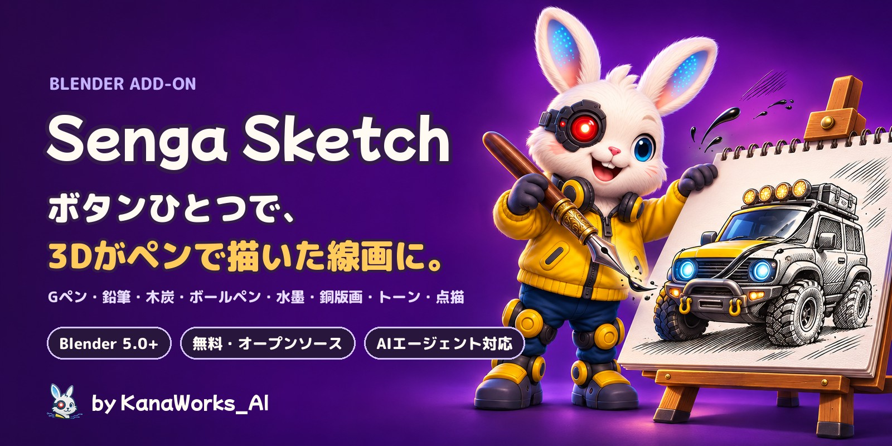
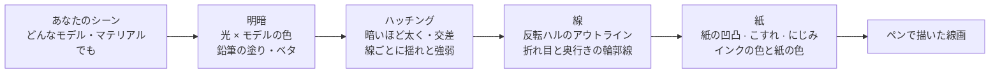

<div align="center">



<p>
  <a href="https://github.com/kanaworksai-hue/senga-sketch/releases/latest"></a>
  
  
  
  
  <a href="LICENSE"></a>
  <a href="NOTICE.md"></a>
  <a href="https://github.com/kanaworksai-hue/senga-sketch/stargazers"></a>
</p>

<p><a href="https://github.com/kanaworksai-hue"></a>&nbsp;<a href="https://github.com/kanaworksai-hue"><b>KanaWorks_AI のプロジェクト</b></a>&nbsp;·&nbsp;<a href="#-kanaworks-のアドオン">シリーズ一覧</a></p>

**日本語** | [English](README.en.md) | [简体中文](README.zh-CN.md) | [한국어](README.ko.md) | [Português](README.pt-BR.md) | [Español](README.es.md)

[🎨 ギャラリー](#-ギャラリー) · [🚀 はじめかた](#-はじめかた) · [🎛️ 調整できること](#️-調整できること) · [❓ FAQ](#-faq) · [⭐ Star で応援](#-star-で応援する)

</div>

**Senga Sketch（線画スケッチ）** は、Blender のシーンをボタンひとつで「ペンで描いた線画」に変える、無料の Blender アドオンです。光の当たり方から明暗をとり、暗いところほど手描きの斜線（ハッチング）を重ね、ペンのアウトラインと内側の輪郭線を引いて、紙の上に仕上げます。

**Gペン・鉛筆デッサン・木炭・ボールペン・水墨・銅版画・マンガのトーン・点描**の8つの画材と、**スケッチブック・セピア・クラフト紙＋白チョーク・黒板・青焼き・淡彩**などの8種類の紙を組み合わせられます。**シャッフル**を押すたびに線の角度や揺れが変わり、インストールから適用まで AI エージェントに一言で頼むこともできます。

<p align="center">
  
  <br><sub>同じモデル、同じカメラ。左が普通のレンダリング、右が Senga Sketch。</sub>
</p>

## ✨ 特長

<table>
<tr>
<td align="center" width="25%"><br><b>ワンクリック</b><br><sub>EEVEE、マテリアル、アウトライン、輪郭線、紙まで一括で設定</sub></td>
<td align="center" width="25%"><br><b>画材8種 × 紙8種</b><br><sub>Gペン・鉛筆・木炭・ボールペン・水墨・銅版画・トーン・点描</sub></td>
<td align="center" width="25%"><br><b>シャッフル</b><br><sub>押すたびに線の角度・間隔・揺れ・かすれ・紙の色味が変わる</sub></td>
<td align="center" width="25%"><br><b>AIにおまかせ</b><br><sub>エージェントに一言。インストール、適用、プレビューまで自動</sub></td>
</tr>
</table>

- **手で描いたようなハッチング：** 線は1本ずつ太さ・間隔・揺れ・長さが違い、入り抜きのある短いストロークに分かれます。暗くなるほど太く、さらに交差線、3層目の線が重なります。線は画面に固定（参考にした線画と同じ）にも、形に沿って曲げることもできます。
- **ペンらしい線：** アウトラインは画面上で一定の太さを保ち、光の反対側で太く、ペンの筆圧のように強弱がつき、2コマ打ちでゆらゆらします。折れ目や重なりからは内側の輪郭線を描き、ベタの中では線を白く抜いて形を残します。
- **紙の上の仕上げ：** 紙の凹凸で鉛筆がかすれ、木炭はこすれ、水墨は墨だまりができます。画面の端（または下）に向かって、陰影から先に、線はあとまで残しながら描きかけのように消していくこともできます。暗い紙では影ではなく光を描き、色紙には白チョークでハイライトを入れます。
- **どんなシーンでも動く：** マテリアルのないオブジェクトには自動でマテリアルを作り（頂点カラーも保持）、ライトがなければキーライトを足します。画像・Diffuse・Emission のマテリアル、テキスト、カーブ、コレクションインスタンスにも対応。ガラスはそのまま残し、輪郭と縁の陰影で描きます。
- **元に戻せる：** 「線画を元に戻す」で元のマテリアル、コンポジター、表示設定に戻ります。値はシェーダーの中で読むので、アドオンがない環境でも同じ見た目でレンダリングできます。
- **UI は 日本語・English・简体中文・한국어：** Blender の言語設定に自動で合わせます。パネル右上の 🌐 メニューで個別に切り替えることもできます。

## 🎨 ギャラリー

### 画材8種

同じモデル、同じライト。画材だけを切り替えました。


### 紙8種

画材と紙は別々に選べます。色紙には白チョーク、黒板と青焼きでは光を描きます。


### 近くで見ると


### シャッフル

押すたびに、線の角度・交差の角度・間隔・揺れ・かすれ・端のフェード・紙の色味が変わります。番号を覚えておけば、同じ見た目をいつでも再現できます。


### どんなモデルにも

CC0 のモデル、Blender 標準のスザンヌ、作者が用意したモデルに、ボタン1回で適用しました。


### 4つのレイヤー


## 🧭 しくみ



1. **明暗とハッチング（マテリアル）：** Diffuse → Shader to RGB で光をとり、モデルの色の明るさと掛け合わせて「暗さ」を作ります。暗さに応じて、画面座標で引いた手描きの線（1本ずつ太さ・位置・揺れ・長さが違う）を太くし、交差線を重ね、いちばん暗いところはベタにします。値は線の「インク量」として AOV に書き出します。
2. **線（ジオメトリノード＋コンポジター）：** 反転ハルで、画面上で一定の太さのアウトラインを作り、光の反対側で太く、筆圧のように強弱をつけます。コンポジターでは、法線の折れ目と（アンチエイリアスされた）奥行きの段差から内側の輪郭線を描きます。
3. **紙（コンポジター）：** インク量に紙の凹凸・こすれ・にじみ・描きかけのフェードをかけてから、「紙の色 × 淡彩」の上に「インクの色」をのせます。だから白い紙に黒インクも、黒板に白チョークも同じしくみで描けます。ピクセル単位の値は解像度に合わせて自動で変わります。

## 🚀 はじめかた

### AI エージェントに頼む（おすすめ）

Claude Code や Codex のような、パソコンを操作できる AI エージェントにこう送るだけです。

> https://github.com/kanaworksai-hue/senga-sketch の AGENTS.md に従って Senga Sketch をインストールして、私の Blender シーンをペンで描いた線画っぽくして。

そのあとは、プレビューを見ながら一言で直せます。

- 「鉛筆デッサンにして」
- 「クラフト紙に白チョークで」
- 「別のパターンも見せて」
- 「線をもっと細かく」
- 「下のほうを描きかけみたいに消して」

### 自分でインストールする

**必要なもの：** Blender 5.0 以降（Blender 5.2 で動作確認済み）、レンダーエンジンは EEVEE。

1. [Releases](https://github.com/kanaworksai-hue/senga-sketch/releases/latest) から `senga_sketch-x.y.z.zip` をダウンロード（解凍しないでください）
2. Blender → 編集 → プリファレンス → エクステンションを入手 → 右上の ⌄ → **ディスクからインストール…** → zip を選択


### 使い方

1. シーンを開く（モデルやマテリアルは何でも OK）
2. 3D ビューで **N** キー → **Senga** タブ
3. **Make It Senga**（線画にする）
4. **画材**と**紙**を選ぶ。迷ったら **シャッフル**
5. 「トーン（明暗）」「ハッチング」「線」「紙と色」で微調整して、**F12** でレンダリング

<p align="center">
  
</p>

## 🎛️ 調整できること

<details>
<summary><b>メインパネル</b></summary>

| 項目 | 内容 |
|---|---|
| 画材 | 描き方（Gペン・鉛筆デッサン・木炭・ボールペン・水墨・銅版画・マンガのトーン・点描） |
| 紙 | 紙とインクの色（スケッチブック・セピア・クラフト紙＋白チョーク・グレーの色紙＋チョーク・ノート・青焼き・黒板・淡彩） |
| バリエーション / シャッフル | 線の角度・間隔・揺れ・かすれ・端のフェード・紙の色味をランダムに変える番号。0 でオフ |
| 選択中のオブジェクトのみ | 選んだものだけに適用（初期設定はシーン全体） |
| キーライトがなければ追加 | ライトが1つもないとき、カメラ側からのサンを追加（元に戻すで削除） |
| シーンのスケールに合わせる | 線の太さと奥行きの輪郭線を、大きさとカメラ距離に合わせる |
| 線画を元に戻す / 初期値に戻す | 元のマテリアル・コンポジター・表示設定に戻す / すべての設定を初期値に |

</details>

<details>
<summary><b>画材</b></summary>

| 画材 | 仕上がり |
|---|---|
| **マンガのペン（Gペン）**（初期設定） | 影で太くなる手描きのハッチング、ベタ、軽い鉛筆の塗り |
| **鉛筆デッサン** | やわらかい鉛筆の陰影、細いハッチング、紙の凹凸とこすれ、薄い線 |
| **木炭** | こすれた濃い黒、粗いタッチ、ざらざらの紙、やわらかい線 |
| **ボールペン** | 細い交差線だけ。ノートの落書きのように |
| **墨の濃淡（水墨）** | 筆の輪郭と、3段の墨の濃淡、墨だまり |
| **銅版画** | 形に沿って曲がる細い線。エッチングや紙幣のように |
| **マンガのトーン** | きれいなペン線と、2段階の網点 |
| **点描** | 何千もの点で描く陰影 |

画材は「描き方」の値だけを変え、紙は「色と雰囲気」の値だけを変えるので、自由に組み合わせられます。
</details>

<details>
<summary><b>おもな細かい設定</b></summary>

| グループ | 項目 |
|---|---|
| トーン（明暗） | キーライト・影のしきい値・やわらかさ・セルシェーディング・影の明るさ・明るさ・テクスチャの明暗・暗い色の持ち上げ・光沢・鉛筆の塗り・ベタ・かすれ |
| ハッチング | パターン（ハッチング / スクリーントーン / 点描）・開始・交差・3層目・**線の間隔**・太さ・**角度**・手の揺れ・かすれ・**立体に沿わせる**・明暗の段階 |
| 線 | アウトライン（幅・濃さ・筆圧・**影側を太く**・ブル）、輪郭線（強さ・折れ目・奥行き・幅・揺れ・かすれ・**ベタの中の白線**） |
| 紙と色 | インクの色・紙の色・紙の質感・紙の凹凸・こすれ・にじみの縁・**描きかけの余白**（四方 / 下）・淡彩・白チョーク・光を描く・罫線・粒子・周辺減光 |

オブジェクトごとに、しきい値・影の明るさ・明るさ・塗り・ベタ・ハッチング・淡彩・光沢・線の太さを上書きすることもできます（「アクティブオブジェクトの上書き」）。
</details>

## ❓ FAQ

<details>
<summary><b>Cycles でも使えますか？</b></summary>

使えません。EEVEE 専用の「Shader to RGB」ノードを使っているため、EEVEE でレンダリングしてください。**Make It Senga** を押すと EEVEE に切り替わります。
</details>

<details>
<summary><b>ハッチングがグレーにつぶれて見えます。</b></summary>

線の間隔は画像の高さに対する割合で決まるので、小さなプレビューでは線が細かすぎてグレーに見えます。最終解像度で確認するか、「線の間隔」を広げてください。
</details>

<details>
<summary><b>線が太すぎる・細すぎます。</b></summary>

カメラを大きく動かしたあとは「シーンに合わせる」を押してから、「線の幅」で調整してください。線の幅は画面上で一定になるように作られています。
</details>

<details>
<summary><b>全部明るくて影が出ません。</b></summary>

明るいワールドや HDRI は補助光が強いので、「環境光の補正」を上げるか、「影のしきい値」を上げてください。
</details>

<details>
<summary><b>元のマテリアルはどうなりますか？</b></summary>

線画のノードグループを差し込み、元のつながりを覚えておきます。「線画を元に戻す」で元どおりになります。アドオンが自動で作ったマテリアルやライトも削除されます。
</details>

<details>
<summary><b>作った画像や動画は商用で使えますか？</b></summary>

はい。Senga Sketch で作ったレンダリング画像や動画は、あなたの作品として自由に使えます。GPL が適用されるのはアドオン本体のコードで、それを使って作った作品には及びません（使ったモデルやテクスチャのライセンスには従ってください）。クレジットは必要ありませんが、`Made with Senga Sketch by @KanaWorks_AI` と入れてもらえると嬉しいです。
</details>

## 📝 クレジット表記

Senga Sketch は無料で、商用でも使えます。

**アドオンを再配布・改変・同梱するとき**（フォーク、改変版、移植版、パックや製品への同梱など。有償・無償を問いません）は、次の表記をアドオンの説明文とドキュメントにそのまま残すことが**必須**です（GPL-3.0 第7条(b)に基づく追加条項。詳しくは [NOTICE.md](NOTICE.md)）。

```
Senga Sketch by KanaWorks_AI (@KanaWorks_AI) — https://github.com/kanaworksai-hue/senga-sketch
```

**作った画像や動画**にはクレジットは必要ありません。よければ投稿文や概要欄に入れてもらえると嬉しいです。

```
Made with Senga Sketch by @KanaWorks_AI
```

## ⭐ Star で応援する

Senga Sketch を気に入ったら、[リポジトリのページ](https://github.com/kanaworksai-hue/senga-sketch)の右上にある **⭐ Star** を押してもらえると嬉しいです。無料で、1秒で終わります。

- **もっと多くの人に届く：** Star が増えると GitHub で見つけてもらいやすくなります。
- **アップデートの励みになる：** 新しい画材や紙を作り続ける力になります。

ほかにも、バグや欲しい機能を [Issue](https://github.com/kanaworksai-hue/senga-sketch/issues) で教えてもらったり、作品を X で [@KanaWorks_AI](https://x.com/KanaWorks_AI) をつけて見せてもらえたりすると、とても励みになります。

## 🧩 KanaWorks のアドオン

同じ作者の、無料・オープンソースの Blender アドオンです。どれも AI エージェントに一言で頼めます。

<table>
<tr>
<td align="center" width="50%"><a href="https://github.com/kanaworksai-hue/senga-sketch"></a><br><b>Senga Sketch</b>（このページ）<br><sub>3D をペンで描いた線画に。ハッチング・鉛筆・銅版画・トーン</sub></td>
<td align="center" width="50%"><a href="https://github.com/kanaworksai-hue/painterly-25d"></a><br><b><a href="https://github.com/kanaworksai-hue/painterly-25d">Painterly 2.5D</a></b><br><sub>3D を手描きの絵に。油絵・水彩・クレヨン・アニメ塗り</sub></td>
</tr>
<tr>
<td align="center" width="50%"><a href="https://github.com/kanaworksai-hue/kirapaint"></a><br><b><a href="https://github.com/kanaworksai-hue/kirapaint">KiraPaint</a></b><br><sub>3D をキラキラの絵画風 2.5D に。砕いたダイヤのツヤと星の光</sub></td>
<td align="center" width="50%"><a href="https://github.com/kanaworksai-hue/mochitoon"></a><br><b><a href="https://github.com/kanaworksai-hue/mochitoon">MochiToon</a></b><br><sub>3D をかわいいマンガ風に。色つきの影、ハートや星の網点</sub></td>
</tr>
</table>

## 🛠️ 開発

```bash
# ヘッドレステスト（調整していない汎用シーンで全機能を確認）
blender -b --factory-startup --python tests/test_generic.py

# 配布用の zip を dist/ に作成
BLENDER=blender ./build.sh
```

```
senga_sketch/
  __init__.py      設定、画材・紙・バリエーション、オペレーター
  shade.py         線画のシェーダーノードグループ（明暗、ハッチング、網点・点描、ベタ、淡彩、AOV）
  outline.py       ジオメトリノードのアウトライン（光の反対側で太く、筆圧、ブル）
  post.py          コンポジター（輪郭線、白線、紙の凹凸、こすれ、にじみ、描きかけのフェード、紙とインク）
  autosetup.py     どんなシーンでも動かすための自動設定（マテリアル、ライト、スケール）
  ui.py / i18n.py  パネルと UI の翻訳（日本語・English・简体中文・한국어）
agent/senga_agent.py  AI エージェント用のコマンドライン
```

## 📄 ライセンスとクレジット

- **このアドオン：** Copyright © 2026 東京AI映像合同会社。[GPL-3.0-or-later](LICENSE) で公開しています（再配布時のクレジット表記を求める追加条項付き。[NOTICE.md](NOTICE.md)）。
- **ブランド：** KanaWorks_AI の名称、ロゴ、キャラクター Kana の権利は東京AI映像合同会社に帰属し、GPL の対象**外**です。詳しくは [docs/brand](docs/brand/README.md) を見てください。
- 3D を手描きのペン画のように見せる NPR の表現（Shader to RGB による明暗、画面空間のハッチング、反転ハルのアウトライン、法線と奥行きからの輪郭線抽出）は、Blender や Maya / Arnold のコミュニティで広く共有されている手法を参考にしています。
- **Blender** は Blender Foundation の商標です。本プロジェクトは独立したプロジェクトで、Blender Foundation とは提携しておらず、承認も受けていません。

<br>

<div align="center">

<a href="https://x.com/KanaWorks_AI"></a>

<p><b>Made with ♥ by <a href="https://x.com/KanaWorks_AI">KanaWorks_AI</a></b></p>

<p><sub>Senga Sketch が役に立ったら、⭐ が次のアップデートの励みになります。ほかのプロジェクト：<a href="https://github.com/kanaworksai-hue">github.com/kanaworksai-hue</a></sub></p>

</div>
