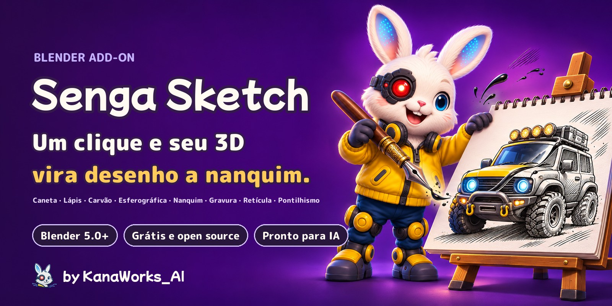
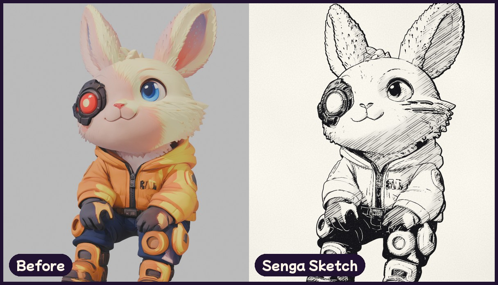
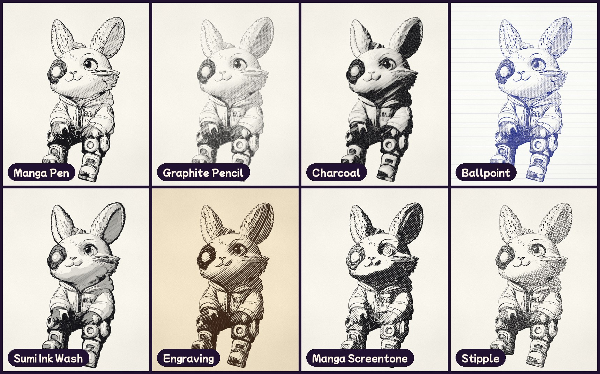
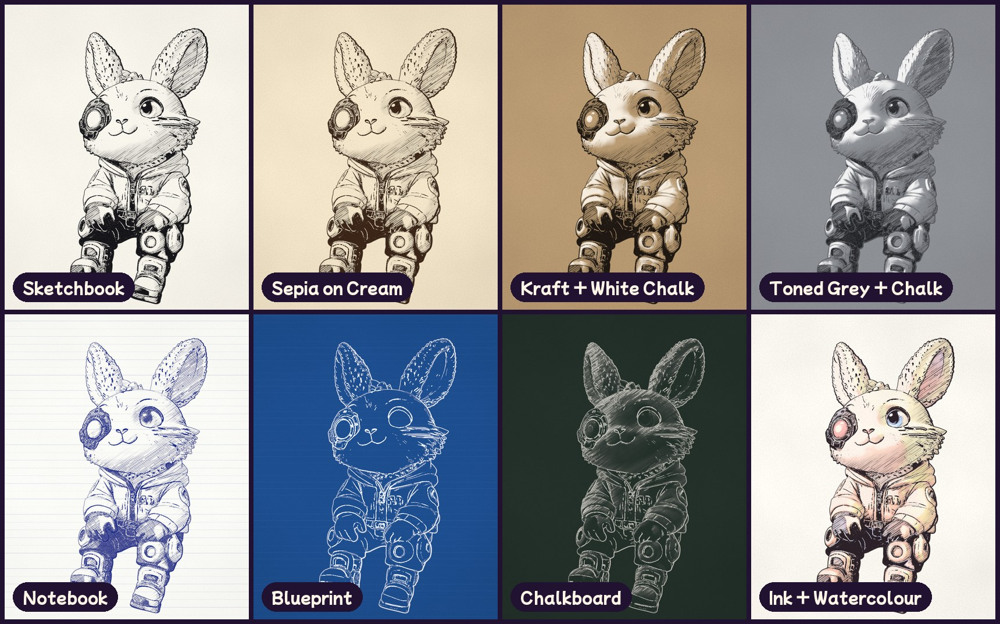
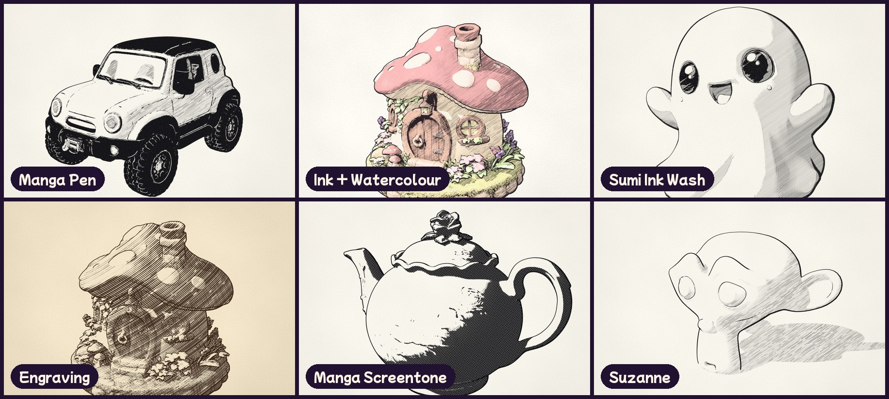
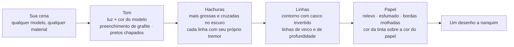

<div align="center">



<p>
  <a href="https://github.com/kanaworksai-hue/senga-sketch/releases/latest"></a>
  
  
  
  
  <a href="LICENSE"></a>
  <a href="NOTICE.md"></a>
  <a href="https://github.com/kanaworksai-hue/senga-sketch/stargazers"></a>
</p>

<p><a href="https://github.com/kanaworksai-hue"></a>&nbsp;<a href="https://github.com/kanaworksai-hue"><b>Um projeto KanaWorks_AI</b></a>&nbsp;·&nbsp;<a href="#-add-ons-da-kanaworks">Todos os add-ons</a></p>

[日本語](README.md) | [English](README.en.md) | [简体中文](README.zh-CN.md) | [한국어](README.ko.md) | **Português** | [Español](README.es.md)

[🎨 Galeria](#-galeria) · [🚀 Primeiros passos](#-primeiros-passos) · [🎛️ O que dá para ajustar](#️-o-que-dá-para-ajustar) · [❓ Perguntas frequentes](#-perguntas-frequentes) · [⭐ Deixe uma estrela](#-apoie-com-uma-estrela)

</div>

**Senga Sketch** (線画スケッチ, "esboço em traço") é um add-on gratuito para Blender que transforma a sua cena em um desenho a nanquim com um clique só. Ele lê a luz e a sombra, aplica hachuras feitas à mão onde a cena fica mais escura, passa tinta nos contornos e nas linhas internas e finaliza tudo sobre papel.

Combine **8 técnicas** — pena G de mangá, lápis grafite, carvão, caneta esferográfica, aguada de nanquim sumi, gravura, retícula de mangá e pontilhismo — com **8 papéis**, do sketchbook e do sépia ao kraft com giz branco, lousa, blueprint e uma aguada leve de aquarela. Cada clique em **Shuffle** muda o ângulo e o tremor das linhas, e um agente de IA pode instalar e aplicar tudo para você com uma frase.

<p align="center">
  
  <br><sub>Mesmo modelo, mesma câmera. Esquerda: render normal. Direita: Senga Sketch.</sub>
</p>

## ✨ Recursos

<table>
<tr>
<td align="center" width="25%"><br><b>Um clique</b><br><sub>Configura EEVEE, materiais, contornos, linhas internas e papel de uma vez só</sub></td>
<td align="center" width="25%"><br><b>8 técnicas × 8 papéis</b><br><sub>Pena, lápis, carvão, esferográfica, aguada de nanquim, gravura, retícula, pontilhismo</sub></td>
<td align="center" width="25%"><br><b>Shuffle</b><br><sub>Cada clique muda o ângulo, o espaçamento, o tremor e a quebra das linhas e o tom do papel</sub></td>
<td align="center" width="25%"><br><b>Peça para a sua IA</b><br><sub>Uma frase para o seu agente: instalação, aplicação e prévia, tudo automático</sub></td>
</tr>
</table>

- **Hachuras com cara de feitas à mão:** cada linha tem sua própria espessura, espaçamento, tremor e comprimento, e é quebrada em traços que afinam nas pontas. As linhas engrossam conforme a área escurece, e depois entram uma camada cruzada e uma terceira camada. Deixe as linhas fixas na tela (como no desenho que inspirou este visual) ou faça com que elas se curvem acompanhando a forma.
- **Linhas como as de uma caneta de verdade:** os contornos mantêm uma espessura constante na tela, ficam mais grossos do lado oposto à luz, engrossam e afinam como a pressão de uma pena e tremem de dois em dois quadros. As linhas internas vêm de vincos e sobreposições; dentro dos pretos chapados, elas são riscadas em branco para que a forma continue legível.
- **Acabamento sobre papel:** o relevo do papel quebra o traço do lápis, o carvão esfuma e a aguada de nanquim se acumula nas bordas. O desenho pode ir sumindo em direção às bordas do quadro (ou à parte de baixo) como um esboço inacabado — primeiro some o sombreado, por último as linhas. Em papel escuro, ele desenha a luz em vez da sombra; papéis tonalizados ganham realces em giz branco.
- **Funciona em qualquer cena:** objetos sem material ganham um (as cores de vértice são mantidas) e, se a cena não tiver luz, uma luz principal é adicionada. Materiais de imagem, Diffuse e Emission, textos, curvas e instâncias de coleção também entram. O vidro mantém o próprio shader e é desenhado com contorno e um tom na borda.
- **Dá para desfazer tudo:** "Revert Sketch" restaura seus materiais originais, o compositor e as configurações de visualização. As configurações são lidas dentro do shader, então o arquivo renderiza igual mesmo sem o add-on instalado.
- **Interface em 日本語, English, 简体中文 e 한국어:** segue o idioma do Blender automaticamente, ou escolha um no menu 🌐 no canto superior direito do painel.

## 🎨 Galeria

### 8 técnicas

Mesmo modelo, mesma luz. Só a técnica muda.



### 8 papéis

Técnicas e papéis são escolhidos separadamente. Papéis tonalizados ganham giz branco; lousa e blueprint desenham a luz.



### De perto


### Shuffle

Cada clique sorteia de novo o ângulo da hachura, o ângulo da hachura cruzada, o espaçamento, o tremor, a quebra das linhas, o esmaecimento nas bordas e o tom do papel. Anote o número e você recupera exatamente o mesmo visual quando quiser.


### Qualquer modelo

Modelos CC0, a Suzanne do próprio Blender e modelos da autora, cada um com um único clique.



### Quatro camadas


## 🧭 Como funciona



1. **Tom e hachuras (material):** Diffuse → Shader to RGB fornece a luz, que é multiplicada pelo brilho da cor do próprio modelo. Essa escuridão comanda linhas desenhadas à mão aplicadas no espaço da tela (cada uma com sua própria espessura, posição, tremor e comprimento): elas engrossam, se cruzam, e as áreas mais escuras viram preto chapado. O resultado é gravado em um AOV como "cobertura de tinta".
2. **Linhas (Geometry Nodes + compositor):** um casco invertido desenha contornos com espessura constante na tela, mais grossos do lado oposto à luz e com variação de pressão de pena. O compositor adiciona linhas internas a partir dos vincos das normais e dos saltos de profundidade (com anti-aliasing).
3. **Papel (compositor):** o relevo do papel, o esfumado, as bordas molhadas e o esmaecimento de esboço inacabado agem sobre a cobertura de tinta, e então a "cor da tinta" é aplicada sobre "cor do papel × aguada". É por isso que tinta preta em papel branco e giz branco em um quadro-negro usam o mesmo grafo. Os tamanhos em pixels acompanham a resolução automaticamente.

## 🚀 Primeiros passos

### Peça para o seu agente de IA (recomendado)

Mande isto para um agente de IA que consiga usar o seu computador, como o Claude Code ou o Codex:

> Siga o AGENTS.md de https://github.com/kanaworksai-hue/senga-sketch para instalar o Senga Sketch e deixar a minha cena do Blender com cara de desenho a nanquim.

Depois, é só ir ajustando com uma frase enquanto olha a prévia:

- "Faz um estudo a lápis"
- "Papel kraft com giz branco"
- "Me mostra outra variação"
- "Hachuras mais finas"
- "Deixa a parte de baixo sumir como um esboço inacabado"

### Instalar manualmente

**Você precisa de:** Blender 5.0 ou mais recente (testado no Blender 5.2) e o motor de render EEVEE.

1. Baixe o `senga_sketch-x.y.z.zip` em [Releases](https://github.com/kanaworksai-hue/senga-sketch/releases/latest) (não descompacte)
2. Blender → Edit → Preferences → Get Extensions → menu ⌄ no canto superior direito → **Install from Disk…** → escolha o zip


### Como usar

1. Abra a sua cena (qualquer modelo, quaisquer materiais)
2. No 3D Viewport, aperte **N** → aba **Senga**
3. Clique em **Make It Senga**
4. Escolha um **Medium** e um **Paper**. Na dúvida? Clique em **Shuffle**
5. Faça o ajuste fino em Tone, Hatching, Lines e Paper & Colour e renderize com **F12**

<p align="center">
  
</p>

## 🎛️ O que dá para ajustar

<details>
<summary><b>Painel principal</b></summary>

| Opção | O que faz |
|---|---|
| Drawing Medium | Como é desenhado (pena de mangá, lápis grafite, carvão, caneta esferográfica, aguada de nanquim sumi, gravura, retícula de mangá, pontilhismo) |
| Paper | Papel e cor da tinta (sketchbook, sépia, kraft + giz branco, cinza tonalizado + giz, caderno, blueprint, lousa, nanquim + aquarela) |
| Variation / Shuffle | Um número que sorteia de novo o ângulo, o espaçamento, o tremor e a quebra das linhas, o esmaecimento nas bordas e o tom do papel. 0 = desligado |
| Selected Objects Only | Aplica só à seleção (padrão: a cena inteira) |
| Add Key Light if Missing | Adiciona um Sun do lado da câmera quando não há nenhuma luz (o Revert remove) |
| Fit to Scene Scale | Define a espessura das linhas e as linhas de profundidade a partir do tamanho dos objetos e da distância da câmera |
| Revert Sketch / Reset to Defaults | Restaura os materiais, o compositor e as configurações de visualização / volta todas as opções ao padrão |

</details>

<details>
<summary><b>Técnicas</b></summary>

| Medium | Visual |
|---|---|
| **Manga Pen** (padrão) | Hachuras à mão que engrossam na sombra, pretos chapados, grafite leve |
| **Graphite Pencil** | Sombreado suave de grafite, hachuras finas, relevo do papel e esfumado, linhas leves |
| **Charcoal** | Pretos pesados e esfumados, traços grossos, papel áspero, linhas suaves |
| **Ballpoint** | Só linhas finas cruzadas, como um rabisco de caneta no caderno |
| **Sumi Ink Wash** | Contornos a pincel, três tons chapados de aguada, tinta acumulada nas bordas |
| **Engraving** | Linhas finas que se curvam com a forma, como uma gravura em metal ou uma cédula |
| **Manga Screentone** | Linhas de tinta limpas com pontos de retícula em dois níveis |
| **Stipple** | Sombreado feito com milhares de pontinhos de tinta |

As técnicas mudam só as opções de "como é desenhado" e os papéis só as de "cor e clima", então dá para combinar à vontade.
</details>

<details>
<summary><b>Principais configurações detalhadas</b></summary>

| Grupo | Configurações |
|---|---|
| Tom | Luz principal, limiar da sombra, suavidade, cel shading, claridade da sombra, luminosidade, valores da textura, clareamento de texturas escuras, brilho, preenchimento de grafite, pretos chapados, pincel seco |
| Hachuras | Padrão (hachura / retícula / pontilhismo), início, hachura cruzada, terceira camada, **espaçamento das linhas**, espessura, **ângulo**, tremor da mão, quebra, **seguir a forma**, níveis de tom |
| Linhas | Contornos (espessura, escuridão, pressão da pena, **peso do lado da sombra**, tremor a cada 2 quadros), linhas internas (intensidade, vincos, profundidade, espessura, tremor, quebra, **linhas brancas nos pretos**) |
| Papel e cor | Cor da tinta, cor do papel, textura do papel, relevo do papel, esfumado, bordas molhadas, **bordas inacabadas** (vinheta / parte de baixo), aguada de cor, giz branco, desenhar a luz, pauta, granulação, vinheta |

Por objeto, dá para sobrescrever limiar da sombra, claridade da sombra, luminosidade, preenchimento, pretos chapados, hachuras, aguada de cor, brilho e espessura das linhas ("Active Object Override").
</details>

## ❓ Perguntas frequentes

<details>
<summary><b>Funciona no Cycles?</b></summary>

Não. Ele usa o nó "Shader to RGB", exclusivo do EEVEE, então renderize com o EEVEE. O **Make It Senga** já muda a cena para o EEVEE para você.
</details>

<details>
<summary><b>As hachuras viram um cinza chapado.</b></summary>

O espaçamento das linhas é uma fração da altura da imagem, então em uma prévia pequena as linhas ficam mais finas que um pixel e se misturam em cinza. Confira na resolução final ou aumente o "Line Spacing".
</details>

<details>
<summary><b>As linhas estão grossas ou finas demais.</b></summary>

Depois de mover bastante a câmera, clique em "Fit to Scene" e ajuste o "Line Width". A espessura das linhas foi feita para ficar igual na tela.
</details>

<details>
<summary><b>Está tudo claro e não aparece sombra nenhuma.</b></summary>

Worlds claros e HDRIs adicionam muita luz de preenchimento. Aumente o "Ambient Compensation" ou o "Shadow Threshold".
</details>

<details>
<summary><b>O que acontece com os meus materiais originais?</b></summary>

O node group do esboço é inserido antes da saída do material e a conexão original fica guardada. O "Revert Sketch" coloca tudo de volta e remove os materiais e as luzes que o add-on criou.
</details>

<details>
<summary><b>Posso usar as imagens e os vídeos comercialmente?</b></summary>

Pode. Os renders e vídeos que você fizer com o Senga Sketch são obra sua e podem ser usados comercialmente à vontade. A GPL vale para o código do add-on, não para o que você cria com ele (mas respeite as licenças dos modelos e texturas que usar). Não precisa de créditos, mas `Made with Senga Sketch by @KanaWorks_AI` nos deixaria muito felizes.
</details>

## 📝 Créditos

O Senga Sketch é gratuito, inclusive para uso comercial.

**Ao redistribuir, modificar ou incluir o add-on em outro produto** (forks, versões modificadas, ports, pacotes ou produtos que o incluam, gratuitos ou pagos), é **obrigatório** manter esta linha, sem alterações, na descrição do add-on e na documentação (termo adicional da seção 7(b) da GPL-3.0; veja [NOTICE.md](NOTICE.md)):

```
Senga Sketch by KanaWorks_AI (@KanaWorks_AI) — https://github.com/kanaworksai-hue/senga-sketch
```

**Imagens e vídeos que você fizer** não precisam de créditos. Se quiser colocar, esta linha no post ou na descrição é muito bem-vinda:

```
Made with Senga Sketch by @KanaWorks_AI
```

## ⭐ Apoie com uma estrela

Se você curtiu o Senga Sketch, clique em **⭐ Star** no canto superior direito da [página do repositório](https://github.com/kanaworksai-hue/senga-sketch). É grátis e leva um segundo.

- **Mais gente descobre o projeto:** com mais estrelas, fica mais fácil encontrá-lo no GitHub.
- **Mais atualizações:** é o que mantém novas técnicas e papéis chegando.

Relatos de bugs e ideias em [Issues](https://github.com/kanaworksai-hue/senga-sketch/issues), ou seus desenhos no X marcando [@KanaWorks_AI](https://x.com/KanaWorks_AI), também dão um ânimo enorme.

## 🧩 Add-ons da KanaWorks

Add-ons gratuitos e de código aberto para Blender, da mesma autora. Todos podem ser instalados e aplicados por um agente de IA com uma frase só.

<table>
<tr>
<td align="center" width="50%"><a href="https://github.com/kanaworksai-hue/senga-sketch"></a><br><b>Senga Sketch</b> (esta página)<br><sub>3D em desenho a nanquim: hachuras, lápis, gravura, retícula</sub></td>
<td align="center" width="50%"><a href="https://github.com/kanaworksai-hue/painterly-25d"></a><br><b><a href="https://github.com/kanaworksai-hue/painterly-25d">Painterly 2.5D</a></b><br><sub>3D em arte pintada à mão: óleo, aquarela, giz de cera, cel de anime</sub></td>
</tr>
<tr>
<td align="center" width="50%"><a href="https://github.com/kanaworksai-hue/kirapaint"></a><br><b><a href="https://github.com/kanaworksai-hue/kirapaint">KiraPaint</a></b><br><sub>3D em 2.5D pintado e cintilante: brilho de diamante triturado e reflexos em estrela</sub></td>
<td align="center" width="50%"><a href="https://github.com/kanaworksai-hue/mochitoon"></a><br><b><a href="https://github.com/kanaworksai-hue/mochitoon">MochiToon</a></b><br><sub>3D em toon de quadrinhos fofo: sombras coloridas, retículas de coração e estrela</sub></td>
</tr>
</table>

## 🛠️ Desenvolvimento

```bash
# headless test (every feature on a generic scene the add-on was never tuned for)
blender -b --factory-startup --python tests/test_generic.py

# build the installable zip into dist/
BLENDER=blender ./build.sh
```

```
senga_sketch/
  __init__.py      settings, media / papers / variation, operators
  shade.py         sketch shader node group (tone, hatching, screentone / stipple, solid blacks, wash, AOVs)
  outline.py       Geometry Nodes outline (heavier away from the light, pen pressure, boil)
  post.py          compositor (contours, white lines, paper tooth, smudge, wet edges, unfinished fade, paper and ink)
  autosetup.py     makes it work on any scene (materials, lights, scale)
  ui.py / i18n.py  panel and UI translations (日本語, English, 简体中文, 한국어)
agent/senga_agent.py  command line for AI agents
```

## 📄 Licença e créditos

- **Este add-on:** Copyright © 2026 東京AI映像合同会社 (Tokyo AI Visuals LLC). Distribuído sob a [GPL-3.0-or-later](LICENSE) (com um termo adicional que pede atribuição na redistribuição; veja [NOTICE.md](NOTICE.md)).
- **Marca:** o nome KanaWorks_AI, o logo e a personagem Kana pertencem à Tokyo AI Visuals LLC e **não** são cobertos pela GPL. Veja [docs/brand](docs/brand/README.md).
- As técnicas de NPR que fazem o 3D parecer um desenho a nanquim (tom com Shader to RGB, hachuras no espaço da tela, contornos com casco invertido, extração de linhas a partir de normais e profundidade) são amplamente compartilhadas nas comunidades de Blender e de Maya / Arnold; este add-on se baseia nesse conhecimento comum.
- **Blender** é marca registrada da Blender Foundation. Este é um projeto independente, sem afiliação nem endosso da Blender Foundation.

<br>

<div align="center">

<a href="https://x.com/KanaWorks_AI"></a>

<p><b>Feito com ♥ por <a href="https://x.com/KanaWorks_AI">KanaWorks_AI</a></b></p>

<p><sub>Se o Senga Sketch te ajudou, uma ⭐ mantém a próxima atualização chegando. Mais projetos: <a href="https://github.com/kanaworksai-hue">github.com/kanaworksai-hue</a></sub></p>

</div>
