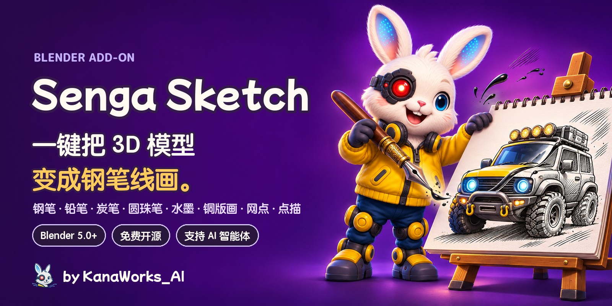
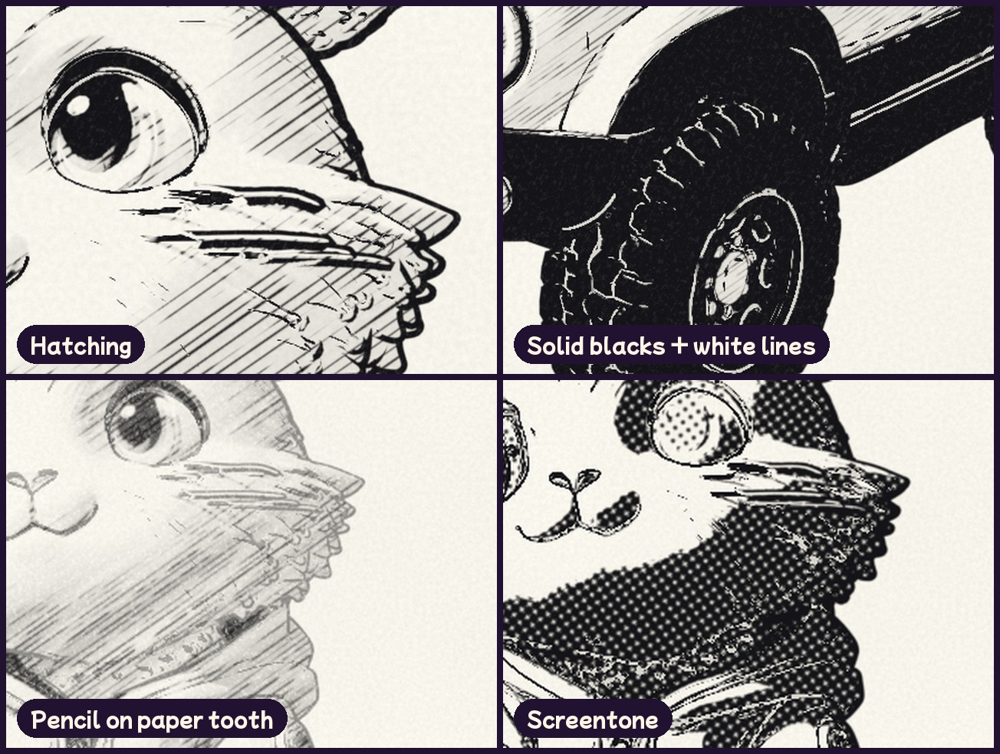
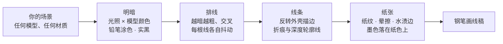
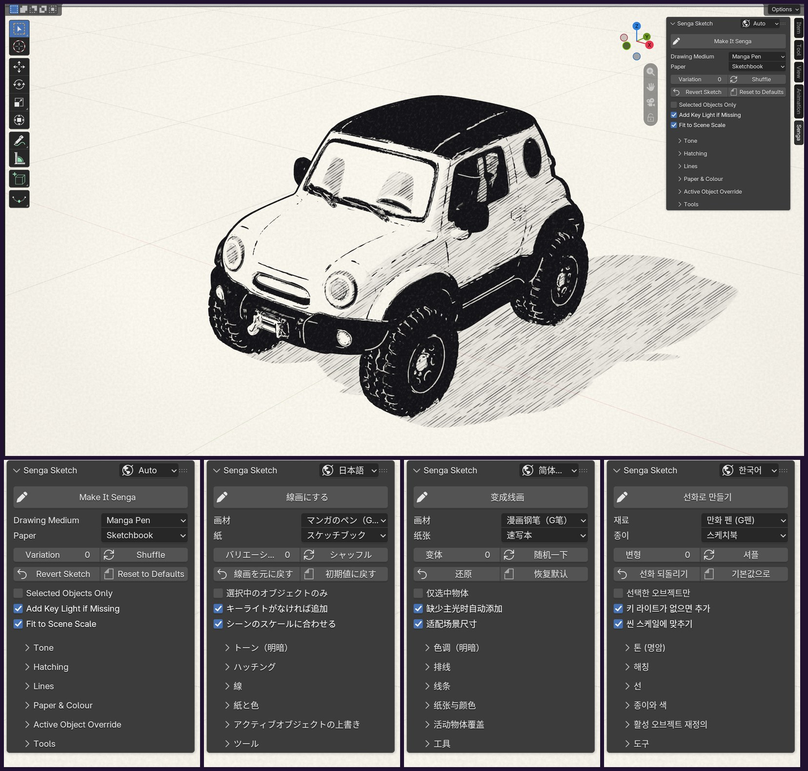

<div align="center">



<p>
  <a href="https://github.com/kanaworksai-hue/senga-sketch/releases/latest"></a>
  
  
  
  
  <a href="LICENSE"></a>
  <a href="NOTICE.md"></a>
  <a href="https://github.com/kanaworksai-hue/senga-sketch/stargazers"></a>
</p>

<p><a href="https://github.com/kanaworksai-hue"></a>&nbsp;<a href="https://github.com/kanaworksai-hue"><b>KanaWorks_AI 的项目</b></a>&nbsp;·&nbsp;<a href="#-kanaworks-的插件">系列一览</a></p>

[日本語](README.md) | [English](README.en.md) | **简体中文** | [한국어](README.ko.md) | [Português](README.pt-BR.md) | [Español](README.es.md)

[🎨 作品展示](#-作品展示) · [🚀 快速开始](#-快速开始) · [🎛️ 可调整的内容](#️-可调整的内容) · [❓ 常见问题](#-常见问题) · [⭐ 点个 Star](#-点个-star-支持一下)

</div>

**Senga Sketch（线画素描）** 是一个免费的 Blender 插件，点一下就能把场景变成"钢笔画的线稿"。它根据光照算出明暗，越暗的地方叠上越多手绘排线，再画上墨线描边和内部轮廓线，最后落在纸上。

**G笔漫画、铅笔素描、炭笔、圆珠笔、水墨、铜版画、漫画网点、点描**八种画材，可以和**速写本、棕褐复古、牛皮纸＋白粉笔、黑板、蓝图、淡彩**等八种纸张自由搭配。每按一次**随机一下（Shuffle）**，排线角度和抖动都会变化；从安装到应用，也可以一句话交给 AI 智能体完成。

<p align="center">
  
  <br><sub>同一模型、同一机位。左边是普通渲染，右边是 Senga Sketch。</sub>
</p>

## ✨ 特点

<table>
<tr>
<td align="center" width="25%"><br><b>一键完成</b><br><sub>EEVEE、材质、描边、轮廓线、纸张一次设置好</sub></td>
<td align="center" width="25%"><br><b>8 种画材 × 8 种纸</b><br><sub>钢笔、铅笔、炭笔、圆珠笔、水墨、铜版画、网点、点描</sub></td>
<td align="center" width="25%"><br><b>随机一下</b><br><sub>每按一次，排线角度、间距、抖动、断笔、纸色都会变化</sub></td>
<td align="center" width="25%"><br><b>交给 AI</b><br><sub>对智能体说一句，自动安装、应用、出预览</sub></td>
</tr>
</table>

- **像手画的排线：** 每根线的粗细、间距、抖动和长度都不一样，并断成有起笔收笔的短笔触。越暗线越粗，再叠上交叉线和第三层线。线可以固定在画面上（和参考的线画一样），也可以顺着形体弯曲。
- **像真笔的线条：** 描边在画面上保持固定粗细，背光一侧更粗，像笔压一样有轻重，并按 2 帧一跳抖动。折痕和前后遮挡处会画出内部轮廓线；在实黑区域里，线条会改成白线，让形状依然清楚。
- **落在纸上：** 纸的颗粒让铅笔断开，炭笔会晕擦，水墨会在边缘积墨。还可以让画面向四周（或向下）像没画完一样淡出——先淡出阴影，线条保留到最后。深色纸上画的是光而不是影，色纸上会加白色粉笔高光。
- **任何场景都能用：** 没有材质的物体会自动建材质（保留顶点色），没有灯光会自动加主光。支持图片 / Diffuse / Emission 材质、文字、曲线和集合实例。玻璃保留原着色器，只画轮廓和边缘的一点明暗。
- **可以还原：** 点"还原"就会恢复原来的材质、合成器和显示设置。所有数值都在着色器里读取，即使没装插件，渲染结果也一样。
- **界面支持 日本語・English・简体中文・한국어：** 自动跟随 Blender 的语言设置，也可以在面板右上角的 🌐 菜单单独切换。

## 🎨 作品展示

### 8 种画材

同一模型、同一灯光，只切换画材。


### 8 种纸张

画材和纸张分开选择。色纸会加白粉笔高光，黑板和蓝图上画的是光。


### 放大看



### 随机一下

每按一次，排线角度、交叉角度、间距、抖动、断笔、边缘淡出和纸色都会重新随机。记下编号，随时都能复现同样的效果。


### 任何模型都可以

CC0 模型、Blender 自带的猴头 Suzanne、作者准备的模型，都只点了一下。


### 四层效果


## 🧭 原理



1. **明暗与排线（材质）：** 用 Diffuse → Shader to RGB 取光照，再乘以模型自身颜色的明度，得到"暗度"。按暗度在屏幕空间画手绘线（每根线的粗细、位置、抖动、长度各不相同）：越暗越粗、再叠交叉线，最暗处填实黑。结果作为"墨量"写入 AOV。
2. **线条（几何节点＋合成器）：** 反转外壳描边在画面上保持固定粗细，背光一侧更粗，并带笔压变化。合成器再从法线折痕和（抗锯齿的）深度跳变画出内部轮廓线。
3. **纸张（合成器）：** 先对墨量施加纸纹、晕擦、水渍边和未完成淡出，再把"墨色"叠在"纸色 × 淡彩"上。所以白纸黑墨和黑板白粉笔用的是同一套节点。像素单位的数值会按分辨率自动换算。

## 🚀 快速开始

### 交给 AI 智能体（推荐）

把下面这句话发给能操作电脑的 AI 智能体，例如 Claude Code 或 Codex：

> 按照 https://github.com/kanaworksai-hue/senga-sketch 的 AGENTS.md 安装 Senga Sketch，然后把我的 Blender 场景做成钢笔线画风。

之后看着预览，一句话就能调整：

- "改成铅笔素描"
- "牛皮纸配白粉笔"
- "再给我看一个变体"
- "排线再密一点"
- "下面像没画完一样淡出"

### 自己安装

**需要：** Blender 5.0 及以上（已在 Blender 5.2 上测试），渲染引擎 EEVEE。

1. 从 [Releases](https://github.com/kanaworksai-hue/senga-sketch/releases/latest) 下载 `senga_sketch-x.y.z.zip`（不要解压）
2. Blender → 编辑 → 偏好设置 → 获取扩展 → 右上角 ⌄ → **从磁盘安装…** → 选择 zip


### 使用方法

1. 打开场景（任何模型和材质都可以）
2. 在 3D 视图按 **N** → **Senga** 标签
3. 点 **Make It Senga**（变成线画）
4. 选择**画材**和**纸张**；拿不定主意就点**随机一下**
5. 在"色调""排线""线条""纸张与颜色"里微调，按 **F12** 渲染

<p align="center">
  
</p>

## 🎛️ 可调整的内容

<details>
<summary><b>主面板</b></summary>

| 项目 | 说明 |
|---|---|
| 画材 | 画法（G笔漫画、铅笔素描、炭笔、圆珠笔、水墨、铜版画、漫画网点、点描） |
| 纸张 | 纸和墨的颜色（速写本、棕褐复古、牛皮纸＋白粉笔、灰色纸＋粉笔、笔记本、蓝图、黑板、钢笔淡彩） |
| 变体 / 随机一下 | 重新随机排线角度、间距、抖动、断笔、边缘淡出和纸色的编号。0 = 关闭 |
| 仅选中物体 | 只处理选中的物体（默认整个场景） |
| 缺少主光时自动添加 | 场景完全没有灯光时，从相机一侧添加日光（还原时删除） |
| 适配场景尺寸 | 根据物体大小和相机距离设置线宽和深度轮廓线 |
| 还原 / 恢复默认 | 恢复原材质、合成器和显示设置 / 所有设置恢复默认 |

</details>

<details>
<summary><b>画材</b></summary>

| 画材 | 效果 |
|---|---|
| **漫画钢笔（G笔）**（默认） | 越暗越粗的手绘排线、实黑、淡淡的铅笔涂色 |
| **铅笔素描** | 柔和的铅笔明暗、细排线、纸纹和晕擦、较浅的线 |
| **炭笔** | 晕开的浓黑、粗犷笔触、粗糙纸面、柔和的线 |
| **圆珠笔** | 只有细细的交叉线，像笔记本上的速写 |
| **水墨** | 毛笔轮廓、三层墨色浓淡、积墨边缘 |
| **铜版画** | 顺着形体弯曲的细线，像蚀刻版画或钞票 |
| **漫画网点** | 干净的墨线配两级网点 |
| **点描** | 用成千上万个墨点堆出的明暗 |

画材只改变"怎么画"，纸张只改变"颜色和氛围"，所以可以自由组合。
</details>

<details>
<summary><b>主要细节设置</b></summary>

| 分组 | 项目 |
|---|---|
| 色调（明暗） | 主光源、阴影阈值、柔和度、赛璐璐分明暗、阴影亮度、亮度、贴图明暗、深色提亮、光泽、铅笔涂色、实黑、枯笔 |
| 排线 | 图案（排线 / 网点 / 点描）、起点、交叉、第三层、**线间距**、粗细、**角度**、手抖、断笔、**沿着形体**、明暗层级 |
| 线条 | 描边（宽度、浓度、笔压、**背光侧加粗**、抖动）、轮廓线（强度、折痕、深度、宽度、抖动、断续、**实黑里的白线**） |
| 纸张与颜色 | 墨色、纸色、纸张纹理、纸张颗粒、晕擦、水渍边、**未完成的边缘**（四周 / 底部）、淡彩、白色粉笔、画光、横格线、颗粒、暗角 |

还可以按物体覆盖阴影阈值、阴影亮度、亮度、涂色、实黑、排线、淡彩、光泽和线宽（"活动物体覆盖"）。
</details>

## ❓ 常见问题

<details>
<summary><b>能在 Cycles 里用吗？</b></summary>

不能。它用到了 EEVEE 专用的"Shader to RGB"节点，请用 EEVEE 渲染。点 **Make It Senga** 会自动切换到 EEVEE。
</details>

<details>
<summary><b>排线糊成了一片灰。</b></summary>

线间距是按图像高度的比例算的，小预览里线比像素还细，就会糊成灰色。请在最终分辨率下查看，或者调大"线间距"。
</details>

<details>
<summary><b>线太粗或太细。</b></summary>

大幅移动相机后，先点"适配场景"，再调"线宽"。线宽在画面上会保持一致。
</details>

<details>
<summary><b>全都很亮，没有阴影。</b></summary>

明亮的世界环境或 HDRI 补光很强。请调高"环境光补偿"或"阴影阈值"。
</details>

<details>
<summary><b>原来的材质会怎样？</b></summary>

插件会在材质输出前插入线画节点组，并记住原来的连接。点"还原"就会恢复，插件自动创建的材质和灯光也会被删除。
</details>

<details>
<summary><b>做出来的图片和视频可以商用吗？</b></summary>

可以。用 Senga Sketch 渲染的图片和视频属于你，可以自由商用。GPL 只适用于插件本身的代码，不涉及你用它做出的作品（请遵守所用模型和贴图的授权）。不需要署名，但如果能加上 `Made with Senga Sketch by @KanaWorks_AI`，我们会很开心。
</details>

## 📝 署名说明

Senga Sketch 免费，也可以商用。

**再分发、修改或打包插件时**（fork、修改版、移植版、放进合集或产品等，无论收费与否），**必须**在插件说明和文档中原样保留下面这行（基于 GPL-3.0 第 7 条 (b) 的附加条款，详见 [NOTICE.md](NOTICE.md)）：

```
Senga Sketch by KanaWorks_AI (@KanaWorks_AI) — https://github.com/kanaworksai-hue/senga-sketch
```

**你做出的图片和视频**不需要署名。如果愿意写在投稿文字或简介里，我们会很开心：

```
Made with Senga Sketch by @KanaWorks_AI
```

## ⭐ 点个 Star 支持一下

喜欢 Senga Sketch 的话，请在[仓库页面](https://github.com/kanaworksai-hue/senga-sketch)右上角点一下 **⭐ Star**。免费，一秒钟就好。

- **让更多人看到：** Star 越多，越容易在 GitHub 上被发现。
- **给更新加油：** 这是继续做新画材和新纸张的动力。

也欢迎在 [Issues](https://github.com/kanaworksai-hue/senga-sketch/issues) 反馈 bug 和想要的功能，或者在 X 上 @[KanaWorks_AI](https://x.com/KanaWorks_AI) 分享你的作品，这对我们是很大的鼓励。

## 🧩 KanaWorks 的插件

同一作者的免费开源 Blender 插件。每一个都可以一句话交给 AI 智能体安装和应用。

<table>
<tr>
<td align="center" width="50%"><a href="https://github.com/kanaworksai-hue/senga-sketch"></a><br><b>Senga Sketch</b>（本页）<br><sub>把 3D 变成钢笔线画：排线、铅笔、铜版画、网点</sub></td>
<td align="center" width="50%"><a href="https://github.com/kanaworksai-hue/harappa"></a><br><b><a href="https://github.com/kanaworksai-hue/harappa">Harappa</a></b><br><sub>一键生成动画背景的原野、树和天空，还有池塘、瀑布和天气</sub></td>
</tr>
<tr>
<td align="center" width="50%"><a href="https://github.com/kanaworksai-hue/painterly-25d"></a><br><b><a href="https://github.com/kanaworksai-hue/painterly-25d">Painterly 2.5D</a></b><br><sub>把 3D 变成手绘画：油画、水彩、蜡笔、赛璐璐</sub></td>
<td align="center" width="50%"><a href="https://github.com/kanaworksai-hue/kirapaint"></a><br><b><a href="https://github.com/kanaworksai-hue/kirapaint">KiraPaint</a></b><br><sub>把 3D 变成闪闪发光的绘画风 2.5D：碎钻光泽和星光</sub></td>
</tr>
<tr>
<td align="center" width="50%"><a href="https://github.com/kanaworksai-hue/mochitoon"></a><br><b><a href="https://github.com/kanaworksai-hue/mochitoon">MochiToon</a></b><br><sub>把 3D 变成可爱漫画风：彩色阴影、爱心和星星网点</sub></td>
<td align="center" width="50%"></td>
</tr>
</table>

## 🛠️ 开发

```bash
# 无界面测试（在没调过参数的通用场景上检查所有功能）
blender -b --factory-startup --python tests/test_generic.py

# 在 dist/ 生成安装用 zip
BLENDER=blender ./build.sh
```

```
senga_sketch/
  __init__.py      设置、画材 / 纸张 / 变体、操作符
  shade.py         线画着色器节点组（明暗、排线、网点 / 点描、实黑、淡彩、AOV）
  outline.py       几何节点描边（背光侧加粗、笔压、抖动）
  post.py          合成器（轮廓线、白线、纸纹、晕擦、水渍边、未完成淡出、纸与墨）
  autosetup.py     让任何场景都能用的自动设置（材质、灯光、尺寸）
  ui.py / i18n.py  面板和界面翻译（日本語・English・简体中文・한국어）
agent/senga_agent.py  给 AI 智能体用的命令行
```

## 📄 授权与致谢

- **本插件：** Copyright © 2026 东京AI映像合同会社（Tokyo AI Visuals LLC）。以 [GPL-3.0-or-later](LICENSE) 发布（附带再分发时保留署名的附加条款，详见 [NOTICE.md](NOTICE.md)）。
- **品牌：** KanaWorks_AI 名称、logo 和 Kana 形象归东京AI映像合同会社所有，**不在** GPL 授权范围内。详见 [docs/brand](docs/brand/README.md)。
- 让 3D 看起来像钢笔画的 NPR 手法（Shader to RGB 取明暗、屏幕空间排线、反转外壳描边、从法线和深度提取轮廓线）在 Blender 和 Maya / Arnold 社区中被广泛分享，本插件以这些通用知识为基础。
- **Blender** 是 Blender Foundation 的商标。本项目是独立项目，与 Blender Foundation 无隶属关系，也未获其认可。

<br>

<div align="center">

<a href="https://x.com/KanaWorks_AI"></a>

<p><b>Made with ♥ by <a href="https://x.com/KanaWorks_AI">KanaWorks_AI</a></b></p>

<p><sub>如果 Senga Sketch 帮到了你，一个 ⭐ 就是下次更新的动力。更多项目：<a href="https://github.com/kanaworksai-hue">github.com/kanaworksai-hue</a></sub></p>

</div>
